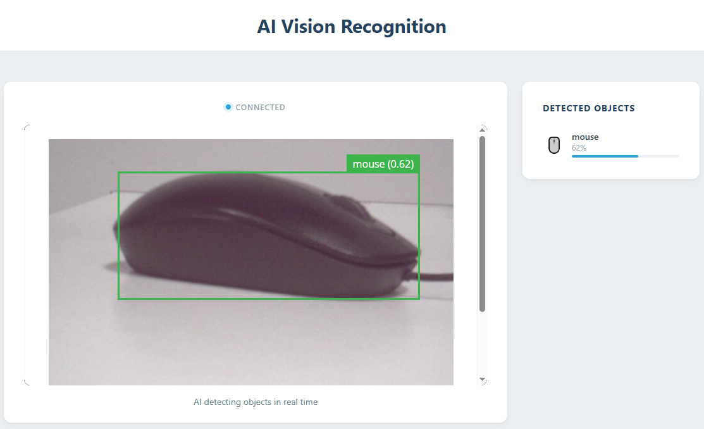

.. include:: /index.rst
   :start-after: start_hello_message
   :end-before: end_hello_message

01 AI Vision Recognition
========================

By now your UNO Q has streamed a live camera feed to a Web UI, and you have been the one watching it and deciding what it means. This lesson flips that around: point the camera at a cup, a person, or a cell phone, and the board itself recognizes what it is looking at — in real time, entirely on the device, with no cloud involved. The detected objects appear on screen, side by side with the live video, each labeled with its name and a confidence score.

In this lesson, you will learn to:

* Start the CSI camera from Python and flip every frame so the preview is upright
* Run the ``VideoObjectDetection`` brick with its general model, and tune the ``confidence`` and ``debounce_sec`` settings
* Read the detections dictionary the model produces and turn it into readable results
* Push live detection results to a custom Web UI over socket.io, complete with icons and confidence bars

1. Setup
--------

**What You Need**

.. list-table::
   :widths: 25 25
   :header-rows: 0

   * - 1 * :ref:`Pan Tilt Kit <pan_tilt_kit>`
     - 1 * USB-C Cable
   * - |list_pan_tilt|
     - |list_usb_cable|

**Software Requirements**

This project uses the following Bricks:

* Bricks (declared in ``app.yaml``):

  * ``video_object_detection`` — runs the **general object-detection** model on every camera frame
  * ``web_ui`` — serves the Web UI with the live camera feed and the Detected Objects panel

.. note::

   Before using the camera, make sure external carriers are enabled on your UNO Q — this is a one-time setup: :ref:`enable_external_carriers`.

No breadboard wiring is needed in this lesson. The CSI camera is already attached to the AVIO Carrier, which is part of your pre-assembled kit — the only "circuit" here is the light entering the lens.

2. Run the App
--------------

#. Download :download:`01 AI Vision Recognition.zip <https://github.com/sunfounder/unoq-ai-kit/releases/latest/download/01.AI.Vision.Recognition.zip>`.
#. In App Lab, go to **Apps** → **Create new app** → **Import App** → **Import from Computer**, and open the package you downloaded.
#. With the app open, click the **Run** button (▶) in the top-right corner. The app boots the camera and loads the AI model, which takes a few seconds the first time.

   .. image:: /img/app_run.png
      :width: 500
      :align: center

#. The **Web UI** opens automatically — the live camera feed on the left and the **Detected Objects** panel on the right. Wait for the status dot to turn blue and the label to change from **Connecting** to **Connected**, then point the camera at an everyday object: a cup, a person, or a cell phone. It appears in the panel with an icon, its name, and a confidence percentage — the higher the percentage, the more certain the model is.

**How it Works**

Now that detections are appearing on screen, let's trace how a frame of video becomes a labeled object in the panel.

* ``01 AI Vision Recognition/`` — the app folder

  * ``app.yaml`` — app metadata and the Bricks it declares (``web_ui`` and ``video_object_detection``)
  * ``README.md`` — project documentation and usage guide

  * ``python/``

    * ``main.py`` — camera access, object detection, and the Web UI

  * ``sketch/``

    * ``sketch.ino`` — idle placeholder; all the work happens on the Linux side
    * ``sketch.yaml`` — sketch configuration

  * ``assets/``

    * ``index.html`` — Web UI structure: the video card and the Detected Objects panel
    * ``app.js`` — browser logic: socket events, object icons, confidence bars
    * ``style.css`` — visual styling
    * ``libs/socket.io.min.js`` — Socket.IO client library
    * ``img/sf_logo.png`` — header logo

The data path from camera frame to on-screen result:

.. mermaid::

   sequenceDiagram
       participant C as Camera (CSI)
       participant P as Python (main.py)
       participant B as Browser (HTML/JS)

       C->>P: frame
       P->>P: adjustments — vertical flip
       P->>P: VideoObjectDetection — general model, confidence 0.4, debounce 1.0 s
       P->>P: on_detect_all → send_detections()
       P-->>B: socket.io "detections" — object, confidence %, timestamp
       B->>B: renderDetections() — icon, name, confidence bar
       B->>P: GET :4912/embed — live video in an iframe

Here's what each piece does:

**Python (main.py)** — runs on the Linux MPU
  * ``Camera(adjustments=...)`` starts the CSI camera and applies the flip to every frame it produces
  * ``VideoObjectDetection(camera, confidence=0.4, debounce_sec=1.0)`` runs the model over each frame

**Sketch (sketch.ino)** — runs on the STM32 MCU
  * ``setup()`` is empty and ``loop()`` only sleeps — the sketch is an idle placeholder
  * All of the AI work happens on the Linux side, so this project never calls across the Bridge

**Browser (HTML/JS)** — runs in the user's browser
  * ``socket.on('detections', ...)`` receives each batch of results and rebuilds the list of rows
  * ``renderDetections()`` draws the icon, name, and confidence bar for every object

**Capturing frames** — ``Camera`` is an App Lab peripheral, not a brick, and once started it keeps producing frames in the background.

**Turning pixels into objects** — ``VideoObjectDetection`` wraps the camera with a pre-trained AI model.

**From detections to data** — the callback receives a dictionary: each key is a class name like ``"cup"``, and its value is a list of every instance of that class found in the frame.

**Getting the results to the screen** — the browser never runs a model; it only renders data.

3. Experiment
-------------

**Watch the Confidence Score Move**

The percentage under each object name is a window into the model's certainty. Wiggle the inputs and watch it respond:

.. list-table::
   :header-rows: 1
   :widths: 45 55

   * - You do
     - Result
   * - Hold a cup about 30 cm from the camera in good light
     - A ``cup`` row appears with a high confidence percentage
   * - Move the cup closer
     - The confidence climbs and the blue bar lengthens
   * - Move the cup far away, into a dim corner
     - The percentage drops — below 40% confidence the model stops reporting it altogether
   * - Show several objects at once (a cup and a phone)
     - Every recognized object gets its own row with its own score
   * - Move everything out of view
     - No new detections arrive; the last rows stay on screen until the next detection message replaces them

4. Troubleshooting
------------------

**The camera area stays black**

* **Cause:** External carriers were never enabled, or the camera port was not enabled before rebooting.
* **Solution:** Complete the one-time setup — enable external carriers and select the camera type for the connector your camera uses, then reboot: :ref:`enable_external_carriers`.

**The page shows Connected but no detections ever appear**

* **Cause:** The object is too small, too far away, or too dark for the model, or it is simply not among the ~80 common categories the general model knows.
* **Solution:** Bring the object close (30 cm or less), keep it in good light, hold it still for a moment, and start with one of the guaranteed examples — a cup, a person, or a cell phone.

**The status shows Disconnected and the app's error banner appears**

* **Cause:** The browser lost its socket connection to the app — the app was stopped, or the board connection dropped.
* **Solution:** Stop the app and run it again, then refresh the Web UI tab.

5. Summary
----------

You just gave your UNO Q a pair of AI eyes — the board can now look at a scene and tell you what is in it, all by itself.

* The ``Camera`` peripheral feeds frames to an AI brick
* ``VideoObjectDetection`` with ``confidence`` and ``debounce_sec`` controls how the model reports what it sees
* ``on_detect_all`` delivers detections to Python as plain data

But so far the AI only *reports* what it sees — it does nothing about it.
