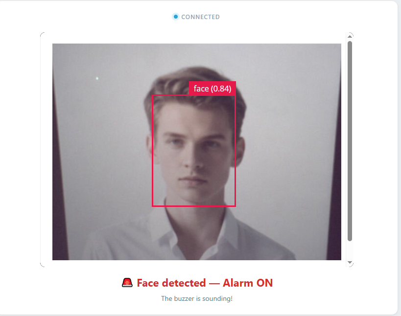

.. include:: /index.rst
   :start-after: start_hello_message
   :end-before: end_hello_message

02 Face Alarm
=============

In the previous project the AI *watched* — it recognized objects and reported them on screen, but nothing happened beyond the Web UI. This lesson crosses that line: the moment the camera sees a face, a buzzer on the breadboard starts sounding an alarm, and when the face leaves, the alarm stops by itself. This is the first time in this module that an AI decision directly drives physical hardware — the AI sees, decides, and acts.

In this lesson, you will learn to:

* Detect faces with the dedicated ``face-detection`` model
* Trigger the buzzer from Python through a ``Bridge.call()``
* Track how long a face has been absent, and stop the alarm automatically
* Follow a complete AI loop: camera → model → Python → sketch → hardware

1. Setup
--------

**What You Need**

.. list-table::
   :widths: 25 25 25 25
   :header-rows: 0

   * - 1 * Pan Tilt Kit
     - 1 * Active :ref:`cpn_buzzer`
     - 1 * :ref:`cpn_breadboard`
     - Several :ref:`cpn_wires`
   * - |list_pan_tilt|
     - |list_active_buzzer|
     - |list_breadboard|
     - |list_wire|
   * - 1 * USB-C Cable
     - -
     - -
     - -
   * - |list_usb_cable|
     - -
     - -
     - -

**Software Requirements**

This project uses the following Bricks:

* Bricks (declared in ``app.yaml``):

  * ``video_object_detection`` — runs the **face-detection** model on every camera frame
  * ``web_ui`` — serves the Web UI with the live camera feed and the alarm status

.. note::

   Before using the camera, make sure external carriers are enabled on your UNO Q — this is a one-time setup: :ref:`enable_external_carriers`.

**Wiring Diagram**

Connect the active buzzer between **D5** and **GND**: the buzzer is polarized, so its **+** pin (or longer leg) goes to D5 and its **−** pin (or shorter leg) to GND, routed through the breadboard with jumper wires. The sketch drives the pin high and low to make it beep, so no extra resistor or transistor is needed.

.. image:: /img/wiring/wiring_ac_buzzer.png
   :width: 500
   :align: center

2. Run the App
--------------

#. Download :download:`02 Face Alarm.zip <https://github.com/sunfounder/unoq-ai-kit/releases/latest/download/02.Face.Alarm.zip>`.
#. In App Lab, go to **Apps** → **Create new app** → **Import App** → **Import from Computer**, and open the package you downloaded.
#. With the app open, click the **Run** button (▶) in the top-right corner. The app boots the camera and loads the face-detection model, which takes a few seconds the first time.

   .. image:: /img/app_run.png
      :width: 500
      :align: center

#. The **Web UI** opens automatically: the live camera feed with the status *"No face — Alarm OFF"* below it. Face the camera — the status flips to *"🚨 Face detected — Alarm ON"* and the buzzer starts beeping rapidly. Step away and the alarm keeps sounding for about two more seconds, then stops and the status returns to *"No face — Alarm OFF"*.

**How it Works**

One AI decision now reaches out of the screen and into the real world, and the work is split the way the UNO Q's two processors are built for it: Python on the Linux MPU decides *whether there is a face*, while the sketch on the STM32 MCU decides *how the buzzer behaves*.

* ``02 Face Alarm/`` — the app folder

  * ``app.yaml`` — app metadata and the Bricks it declares (``web_ui`` and ``video_object_detection`` with ``model: face-detection``)
  * ``README.md`` — project documentation and usage guide

  * ``python/``

    * ``main.py`` — face detection, alarm state, and the Web UI

  * ``sketch/``

    * ``sketch.ino`` — buzzer control and the two Bridge functions Python calls
    * ``sketch.yaml`` — sketch configuration

  * ``assets/``

    * ``index.html`` — Web UI structure: the camera card and the face status line
    * ``app.js`` — browser logic: socket events and status text
    * ``style.css`` — visual styling
    * ``libs/socket.io.min.js`` — Socket.IO client library
    * ``img/sf_logo.png`` — header logo

The data path from a face in front of the lens to a buzzer that sounds:

.. mermaid::

   sequenceDiagram
       participant C as Camera (CSI)
       participant P as Python (main.py)
       participant S as Sketch (sketch.ino)
       participant B as Browser (HTML/JS)

       C->>P: frame
       P->>P: VideoObjectDetection — face-detection model, confidence 0.5, debounce 0.5 s
       P->>P: on_detect("face") → face_detected()
       P->>S: Bridge.call("alarm_on")
       S->>S: beep D5 — 150 ms on, 150 ms off
       P-->>B: socket.io "face_status" — detected
       P->>P: monitor thread — checks every 0.2 s
       P->>S: Bridge.call("alarm_off") — no face for 2.0 s
       S->>S: stop the buzzer
       P-->>B: socket.io "face_status" — no face

Here's what each component does:

**Sketch (sketch.ino)** — runs on the STM32 MCU
  * ``Bridge.provide("alarm_on", alarm_on)`` and ``Bridge.provide("alarm_off", alarm_off)`` register the two functions Python can call
  * ``alarm_on()`` raises the ``alarmActive`` flag; ``alarm_off()`` clears it and immediately drives the pin low

**Python (main.py)** — runs on the Linux MPU
  * ``VideoObjectDetection(camera, confidence=0.5, debounce_sec=0.5)`` runs the ``face-detection`` model declared in ``app.yaml``
  * ``detection.on_detect("face", face_detected)`` fires only for the class this project cares about

**Bridge** — communication channel between MPU and MCU
  * Sketch side: ``Bridge.provide("name", function)`` exposes a function
  * Python side: ``Bridge.call("name")`` invokes it — this is RPC across the two processors

**Browser (HTML/JS)** — runs in the user's browser
  * ``socket.on('face_status', ...)`` flips the status between "🚨 Face detected — Alarm ON" and "No face — Alarm OFF"
  * The live video arrives on its own channel, in an ``<iframe>`` pointed at port 4912 ``/embed``

**The sketch owns the buzzer** — the two Bridge functions are tiny: they only set or clear a flag.

**Python asks for the alarm** — the AI side follows the pattern from the previous project with two differences.

**The first-sighting latch** — a ``face_visible`` flag turns repeated detections into a single alarm: only the first sighting calls ``Bridge.call("alarm_on")``.

**The watchdog thread** — someone has to notice when the face is *gone*, and that cannot happen in the detection callback because it only fires when a face is seen.

3. Experiment
-------------

**Test the Alarm's Behavior**

The alarm has a clear on-condition (a face above 50% confidence) and a timer-based off-condition. Probe both:

.. list-table::
   :header-rows: 1
   :widths: 45 55

   * - You do
     - Result
   * - Show your face to the camera
     - Buzzer starts beeping rapidly; Web UI shows "🚨 Face detected — Alarm ON"
   * - Step out of view for about one second, then come back
     - The buzzer never stops — the alarm refreshes as long as faces keep being seen
   * - Step out of view and stay away
     - The buzzer stops about two seconds after the last sighting; UI returns to "No face — Alarm OFF"
   * - Face the camera and slowly back away
     - Eventually the alarm stops — at that distance the model's confidence drops below 50%
   * - Turn your head so only your profile is visible
     - Detection becomes less reliable; the alarm may flicker on and off

4. Troubleshooting
------------------

**The Web UI shows the alarm is ON, but the buzzer is silent**

* **Cause:** The buzzer is not connected to D5, or its + and − pins are swapped.
* **Solution:** Check the wiring: the + pin goes to D5 and the − pin to GND.

**The buzzer never sounds, even when you face the camera**

* **Cause:** Your face is too far, too small, or too dim for the model to reach the 50% confidence threshold — or the model was still loading in the first seconds after Run.
* **Solution:** Sit 30–60 cm away, face the camera squarely, and keep the room lit.

**The alarm triggers when nobody is there**

* **Cause:** The face detector matched a face-like pattern — a photo, a poster, a face on a phone screen, or a strong shadow — at 50% or higher confidence.
* **Solution:** Move or remove the face-like object, or turn the camera away from it.

5. Summary
----------

Congratulations — your AI has left the screen and touched the physical world!

* A dedicated ``face-detection`` model watches every frame at 50% confidence
* ``on_detect("face", ...)`` fires only for faces, and a latch makes sure the alarm turns on exactly once
* ``Bridge.call("alarm_on")`` and ``Bridge.call("alarm_off")`` let Python command the sketch, which beeps D5 at 150 ms on / 150 ms off

The buzzer answered a yes-or-no question: is there a face?
