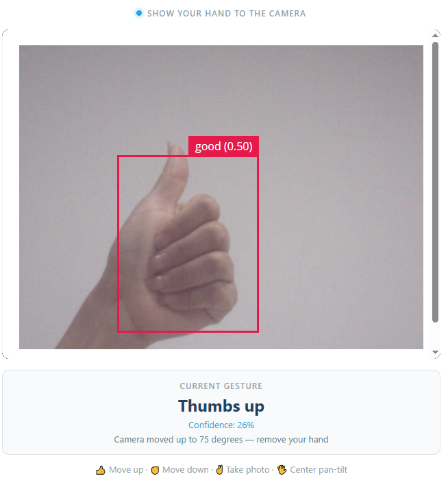

.. include:: /index.rst
   :start-after: start_hello_message
   :end-before: end_hello_message

06 AI Gesture Camera
====================

In the previous project, the AI counted what the camera saw — but the only thing that changed was a number on a page. Nothing in the room moved. This project hands over the controls: **your hand becomes the remote**. A thumbs up tilts the camera up, a fist tilts it down, an open hand sends the pan-tilt back to center, and a V-sign takes a photo. Every gesture also answers you out loud — *"Moving up."*, *"Photo taken."* — so you always know the board understood. The real lesson, though, is not the gestures. It is teaching the UNO Q to tell a **deliberate gesture** apart from a hand that simply happens to be in front of the lens.

In this lesson, you will learn to:

* Run the ``VideoObjectDetection`` brick with its **hand-gestures** model and read the labels it produces
* Turn one gesture into one physical action: a 5° tilt step, a centering move, a photo, or a spoken reply
* Build a **gesture state machine** — a stable window, a lock, and a re-arm rule — so a gesture fires exactly once
* Keep the AI detection callback fast by handing servo, disk, and speech work to a background worker

1. Setup
--------

**What You Need**

.. list-table::
   :widths: 25 25
   :header-rows: 0

   * - 1 * :ref:`Pan Tilt Kit <pan_tilt_kit>`
     - 1 * USB-C Cable
   * - |list_pan_tilt|
     - |list_usb_cable|

**Software Requirements**

This project uses the following Bricks and sketch libraries:

* Bricks (declared in ``app.yaml``):

  * ``video_object_detection`` — runs the **hand-gesture classification** model on every camera frame
  * ``web_ui`` — serves the Web UI with the live camera feed and the gesture card
  * ``sunfounder_tts`` — text-to-speech for the spoken feedback (EdgeTTS)

* Libraries (declared in ``sketch.yaml``):

  * ``Arduino_HardwareServo`` (0.0.1) — drives the pan and tilt servos with hardware PWM

The kit is complete as it comes: the camera is built into the AVIO Carrier, the two servos already carry the pan-tilt bracket, and the carrier's speaker does the talking. There is nothing extra to connect — plug in the USB-C cable and you are ready.

.. note::

   Before using the camera, make sure external carriers are enabled on your UNO Q — this is a one-time setup: :ref:`enable_external_carriers`.

.. note::

   The first time you run a TTS example on this UNO Q, App Lab needs to download and prepare the TTS runtime and audio dependencies. This may take half an hour or more, depending on your network connection. Keep the UNO Q connected to the Internet and wait for the setup to complete. This setup only happens once — after it finishes, every TTS example starts much faster.

**Wiring Diagram**

Plug the pan servo's signal lead into **D9** and the tilt servo's into **D10**, and make sure both servos are powered from the Robot Shield's **5V** and **GND** servo headers, because two servos moving under load draw far more current than a signal pin could ever supply.

.. image:: /img/wiring/wiring_pan_tilt.png
   :width: 600
   :align: center

2. Run the App
--------------

#. Download :download:`06 AI Gesture Camera.zip <https://github.com/sunfounder/unoq-ai-kit/releases/latest/download/06.AI.Gesture.Camera.zip>`.
#. In App Lab, go to **Apps** → **Create new app** → **Import App** → **Import from Computer**, and open the package you downloaded.
#. Click the **Run** button (▶). The pan-tilt swings to its center position (pan 90°, tilt 85°), the Console prints ``AI Gesture Camera is running.`` and then ``[TTS] Ready.`` once the speech engine is up.

#. Open the **Web UI** tab: the live camera feed, the gesture panel reading **Current Gesture: Waiting...**, and a hint line for the four moves (👍 up · ✊ down · ✌️ photo · 🖐️ center). Hold a 👍 **thumbs up** about 50 cm from the camera, steady for about 0.6 s — the panel names it with a confidence and the tilt servo steps up 5° (*"Moving up."*, up to 60°). A ✊ **fist** steps down to 110°, a 🖐️ **open hand** re-centers the pan-tilt, and a ✌️ **V-sign** saves a photo (*"Photo taken."*). Take your hand out of the frame for 3 seconds and the panel returns to **Ready — show a gesture**.

**How it Works**

The whole project is a pipeline with a filter in the middle: frames go in at the top, and at the bottom either a servo moves, a photo is written, or a sentence is spoken — never more than one of those per gesture. The filter is needed because the hand-gestures model runs on every frame and reports what it sees many times per second; if each report triggered an action, one thumbs up would slam the camera into its mechanical limit in a blink.

* ``06 AI Gesture Camera/`` — the app folder

  * Bricks

    * ``video_object_detection`` — the detection model, declared with ``model: hand-gestures`` in ``app.yaml``
    * ``web_ui`` — the Web UI server and socket channel
    * ``sunfounder_tts`` — online text-to-speech through the carrier's speaker

  * Sketch libraries

    * ``Arduino_HardwareServo (0.0.1)`` — hardware-PWM servo control, declared in ``sketch.yaml``

  * Files

    * ``assets/``

      * ``index.html`` — Web UI structure: camera feed, gesture card, hint line
      * ``app.js`` — Browser logic (Socket.IO client)
      * ``style.css`` — Visual styling
      * ``libs/`` — JavaScript libraries (Socket.IO)
      * ``img/`` — Static resources

    * ``python/``

      * ``main.py`` — Gesture state machine, photo capture, speech, and Bridge calls

    * ``sketch/``

      * ``sketch.yaml`` — Sketch configuration and library version
      * ``sketch.ino`` — Servo control on the microcontroller

    * ``README.md`` — Project documentation and usage guide
    * ``app.yaml`` — App metadata (name, icon, bricks used)

The data path from gesture to action:

.. mermaid::

   sequenceDiagram
       participant H as Your hand (camera)
       participant P as Python (main.py)
       participant S as Sketch (sketch.ino)
       participant B as Browser (Web UI)

       H->>P: frames → hand-gestures model (confidence ≥ 0.25)
       P->>P: best_gesture() → label + confidence
       P->>P: same label held for 0.6 s → lock gesture_armed
       P->>P: action_queue.put_nowait((label, confidence))
       P->>S: Bridge.call("tilt_up" / "tilt_down" / "center_pan_tilt")
       S->>S: step 5° within 60°–110°, then pan and tilt back to center
       S-->>P: new tilt angle
       P->>P: take_photo() → camera.capture() → cv2.imwrite()
       P->>B: gesture_result: action + "remove your hand"
       P->>P: tts.say("Moving up.")
       P->>P: re-arm after 5 s and 3 s with no gesture
       P->>B: "Ready — show a gesture"

Here's what each component does:

**Python (main.py)** — runs on the Linux MPU
  * ``detection.on_detect_all(on_detections)`` receives every frame's detections; ``best_gesture()`` keeps the four labels of ``GESTURE_NAMES`` and ignores everything else
  * ``CONFIDENCE_THRESHOLD`` (0.25) decides how sure the model has to be before a label is even considered

**Sketch (sketch.ino)** — runs on the STM32 MCU
  * ``HardwareServo`` drives the pan servo on **D9** and the tilt servo on **D10** with hardware PWM
  * Keeps the only hardware state that matters, ``tiltAngle``, which starts at the ``TILT_CENTER_ANGLE`` of 85°

**Bridge** — communication channel between MPU and MCU
  * Sketch side: ``Bridge.provide("name", function)`` exposes a function
  * Python side: ``Bridge.call("name", args...)`` invokes it and receives its return value

**Browser (index.html / app.js)** — runs in the user's browser
  * Shows the live camera feed from the ``web_ui`` brick, the current gesture, and its confidence
  * ``socket.on('gesture_result')`` writes the gesture name, the confidence percentage, and the action text, including the *"remove your hand"* reminder

3. Experiment
-------------

**Learn the Rhythm of the Lock**

Run the app and try each of these in order. The point is to feel the three timers — the 0.6 s hold, the 5 s lock, and the 3 s re-arm — rather than to memorize them:

.. list-table::
   :header-rows: 1
   :widths: 45 55

   * - You do
     - Result
   * - Hold a thumbs up steady for about 0.6 seconds
     - The page shows **Thumbs up** with a confidence score, the camera tilts up 5° (85° → 80°), and the board says *"Moving up."*
   * - Keep holding that same thumbs up for another ten seconds
     - Nothing else happens — one gesture earns exactly one action, no matter how long the hand stays there
   * - Wave a gesture quickly past the lens and pull it away
     - Nothing fires — the label never survives the full 0.6-second window
   * - Lower your hand and keep it out of the frame for 3 seconds
     - The card flips to **Ready — show a gesture**, the Console prints ``[READY]``, and the app is armed again
   * - Show a fist, then a fist again, then a fist again
     - Each tilt-down is 5°: the camera walks 85° → 90° → 95° → 100° → 105° → 110°, one step per fist
   * - Keep showing a fist once the tilt has reached 110°
     - The camera does not move, and the board says *"Lowest position reached. I cannot move down any further."*
   * - Show a thumbs up five times in a row
     - Five 5° steps later the tilt sits at 60°; one more thumbs up changes nothing and the board says *"Highest position reached. I cannot move up any further."*
   * - Show an open hand
     - The pan returns to 90° and the tilt to 85° while the speaker says *"Back to the center."*
   * - Show a V-sign
     - A new ``gesture_NNN.jpg`` appears in ``/app/photos/`` and the board says *"Photo taken."*
   * - Change straight from a fist into a V-sign without removing your hand
     - The stable timer restarts on the new label, so neither action fires until you hold one of them still

4. Troubleshooting
------------------

**My hand is clearly in the frame but no gesture ever fires**

* **Cause:** The model cannot read the gesture, so ``best_gesture()`` keeps returning nothing and the stable window never even starts.
* **Solution:** Bring your hand to about 50 cm and fill a good part of the frame with it, use a plain light background, and keep your whole hand visible.

**The action fires twice, or fires again while my hand is still there**

* **Cause:** The app is only re-armed after **both** the 5-second action lock **and** 3 seconds with no recognizable gesture.
* **Solution:** Treat removing your hand as part of the gesture.

**The camera moves but there is no sound**

* **Cause:** The TTS runtime is still being prepared, the UNO Q has no Internet connection, or the speech worker failed to start and printed a ``[TTS ERROR]`` line.
* **Solution:** Wait for ``[TTS] Ready.`` on the Console before expecting speech — the very first run can take half an hour to download dependencies, and EdgeTTS synthesizes its audio online, so the board must stay connected to the Internet.

5. Summary
----------

You just taught your UNO Q to take orders from your hand — one wave of a thumbs up and a camera on your desk physically moves.

* How to run the ``VideoObjectDetection`` brick with the **hand-gestures** model and map its labels (``good``, ``neut``, ``five``, ``peace``) to real actions
* Why raw model output has to be filtered: a 0.6-second stable window turns a stream of flickering labels into single, deliberate events
* How a lock plus a re-arm rule — 5 seconds after an action, 3 seconds with no hand in view — guarantees one gesture produces exactly one action

The pattern you built here — detect something, decide whether it is real, then act — is the pattern behind almost every physical AI system.
