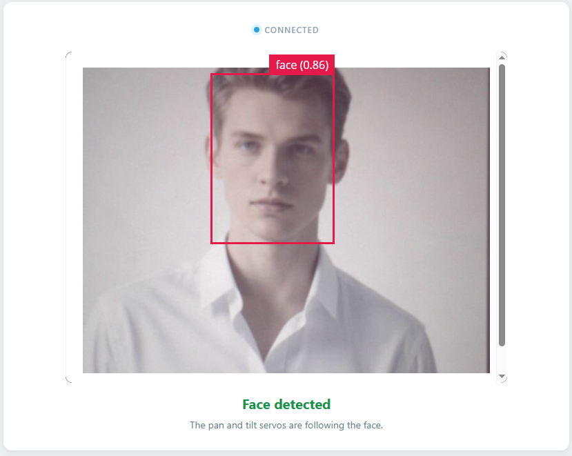

.. include:: /index.rst
   :start-after: start_hello_message
   :end-before: end_hello_message

07 Face Tracking Camera
=======================

The gesture camera moved, but only in fixed steps: one gesture, one 15° nudge, then it waited for you to leave the frame. What if the camera could *keep its eyes on you* instead? In this lesson, the UNO Q not only detects your face — it **follows it**. The pan-tilt camera greets you, then tracks you as you move left, right, up, and down, like a tiny robot that wants to keep you in the center of its view.

In this lesson, you will learn to:

* Greet a face **once per visit** with spoken text ("Nice to meet you.")
* Track a face with a **pan-tilt camera** that moves in both directions
* Use a **dead zone** to prevent servo jitter from tiny movements
* Automatically return the camera to center when the face is lost
* Coordinate the Linux MPU (AI + speech) and the STM32 MCU (servos) through Bridge

1. Setup
--------

**What You Need**

.. list-table::
   :widths: 25 25
   :header-rows: 0

   * - 1 * :ref:`Pan Tilt Kit <pan_tilt_kit>`
     - 1 * USB Cable
   * - |list_pan_tilt|
     - |list_usb_cable|

**Software Requirements**

This project uses the following Bricks and sketch library:

* Bricks (declared in ``app.yaml``):

  * ``video_object_detection`` — runs the **face-detection** AI model on every camera frame
  * ``web_ui`` — serves the Web UI with the live camera feed and face status
  * ``sunfounder_tts`` — text-to-speech for the greeting (EdgeTTS)

* Libraries (declared in ``sketch.yaml``):

  * ``Arduino_HardwareServo`` (0.0.1) — drives the servos with hardware PWM

.. note::

   Before using the camera, make sure external carriers are enabled on your UNO Q — this is a one-time setup: :ref:`enable_external_carriers`.

.. note::

   The first time you run a TTS example on this UNO Q, App Lab needs to download and prepare the TTS runtime and audio dependencies. This may take half an hour or more, depending on your network connection. Keep the UNO Q connected to the Internet and wait for the setup to complete. This setup only happens once — after it finishes, every TTS example starts much faster.

**Wiring Diagram**

This lesson uses no breadboard components — everything plugs into the Robot Shield. Plug the pan servo into pin **D9** and the tilt servo into pin **D10** on the Robot Shield's servo headers.

.. image:: /img/wiring/wiring_pan_tilt.png
   :width: 500
   :align: center

2. Run the App
--------------

#. Download :download:`07 Face Tracking Camera.zip <https://github.com/sunfounder/unoq-ai-kit/releases/latest/download/07.Face.Tracking.Camera.zip>`.
#. In App Lab, go to **Apps** → **Create new app** → **Import App** → **Import from Computer**, and open the package you downloaded.
#. Click the **Run** button (▶). The servos move to the 90° center position, the Console prints ``Face Tracking Camera with TTS is running.`` and ``EdgeTTS ready.``, and the sketch banner ``=== Face Tracking Camera ===`` appears over serial.

#. Open the **Web UI** tab: the live camera feed with the status **Looking for a face**. Stand in front of the camera — the board greets you with *"Nice to meet you."* and the status flips to **Face detected**; move left and right, then duck and rise, and the camera follows to keep your face centered. Step out of view and after about 2.5 seconds it returns to center, ready to greet the next face.

**How it Works**

Now that you've seen the camera follow you, here is what happens between a face appearing in the frame and a servo moving.

An App Lab project is a folder containing multiple files. Here's what each one does:

* ``07 Face Tracking Camera/`` — the app folder

  * ``app.yaml`` — App metadata: declares the ``video_object_detection``, ``web_ui``, and ``sunfounder_tts`` bricks

  * ``python/``

    * ``main.py`` — Face detection, greeting speech, and the tracking decisions

  * ``sketch/``

    * ``sketch.yaml`` — Sketch configuration (declares the ``Arduino_HardwareServo`` library)
    * ``sketch.ino`` — Servo control on the microcontroller

  * ``assets/``

    * ``index.html`` — Web UI structure (camera frame and face status)
    * ``app.js`` — Browser logic: camera stream and Socket.IO events
    * ``style.css`` — Visual styling
    * ``libs/`` — JavaScript libraries (Socket.IO)
    * ``img/`` — Static resources

  * ``README.md`` — Project documentation and usage guide

The data path from a face in front of the camera to a servo movement — and back:

.. mermaid::

   sequenceDiagram
       participant C as Camera (CSI)
       participant P as Python (main.py)
       participant S as Sketch (sketch.ino)
       participant B as Browser (HTML/JS)

       C->>P: frame (flipped vertically)
       P->>P: VideoObjectDetection → send_detections()
       P->>P: box_center() vs. the middle of the frame
       P->>P: EdgeTTS speaks "Nice to meet you." — first sighting only
       P-->>B: face_status {detected: true}
       P->>S: Bridge.call("pan_step", ±1)
       P->>S: Bridge.call("tilt_step", ±1)
       S->>S: servo.write(angle) — one degree, clamped
       P->>S: Bridge.call("center_pan_tilt", "") — no face for 2.5 s
       P-->>B: face_status {detected: false}

Here's what each component does:

**Sketch (sketch.ino)** — runs on the STM32 MCU
  * ``panServo.attach(9)`` and ``tiltServo.attach(10)`` bind the servos to **D9** (pan) and **D10** (tilt)
  * ``Bridge.provide()`` registers the three functions Python may call — ``pan_step``, ``tilt_step``, and ``center_pan_tilt``

**Python (main.py)** — runs on the Linux MPU
  * ``Camera(adjustments=lambda frame: frame[::-1, :])`` flips every frame vertically, because the CSI camera is mounted upside down on the carrier
  * ``VideoObjectDetection(camera, confidence=0.5, debounce_sec=0.1)`` runs the **face-detection** model on each frame

**Bridge** — communication channel between MPU and MCU
  * Python side: ``Bridge.call("pan_step", direction)`` invokes a sketch function across the two processors
  * Sketch side: ``Bridge.provide("pan_step", panStep)`` exposes that function

**Browser (HTML/JS)** — runs in the user's browser
  * The camera feed is an ``<iframe>`` pointed at the stream URL on port 4912 (``/embed``), reloaded once a second until it appears
  * ``socket.on("face_status", …)`` switches the label between **Face detected** and **Looking for a face**, and updates the hint text below it

**Why the dead zone?** — Offsets smaller than 10% of the frame (64 px horizontally, 48 px vertically) are ignored.

**One greeting per visit** — The greeting is not triggered by every detection, or the board would chatter nonstop.

**One degree at a time** — The AI never decides where to point the camera; it only reports where the face is, in numbers.

3. Experiment
-------------

**Follow the Camera**

Try each of these with the app running and observe what the pan-tilt does:

.. list-table::
   :header-rows: 1
   :widths: 40 60

   * - What you do
     - What the camera does
   * - Step in front of the camera and hold still
     - Greets you once with "Nice to meet you.", then holds the face in the center of the frame
   * - Move slowly left and right
     - The pan servo turns to keep your face centered — about 1° per tracking step
   * - Duck down and stand up
     - The tilt servo moves up and down to follow you
   * - Wobble just a tiny bit (a few centimeters)
     - Nothing — you're inside the 10% dead zone, and the servos stay quiet
   * - Walk away out of view
     - After 2.5 seconds the pan-tilt returns to center and the status reads "Looking for a face"
   * - Step back into view
     - Greets you again — this counts as a new visit

4. Troubleshooting
------------------

**The camera doesn't react to my face at all**

* **Cause:** The camera is not enabled, or the app isn't seeing the model output.
* **Solution:** Check that external carriers are enabled with the camera set to **type1-2lanes** (see the note in Setup).

**The greeting never plays**

* **Cause:** The TTS runtime is still being prepared, or the board has no Internet access.
* **Solution:** The first TTS run can take half an hour to download dependencies — watch the Console for ``EdgeTTS ready.`` before expecting speech.

**The servos don't move, or jitter and chatter**

5. Summary
----------

You just built a camera that sees you, speaks to you, and follows you around — a tiny robot companion!

* How to track a face with two servos, moving the pan and tilt independently
* Why a dead zone keeps servo tracking smooth and jitter-free
* How one-degree incremental steps create fluid, natural motion

In the next lesson, you'll turn this tracking talent into a real security system — one that patrols, detects intruders by their whole body, and raises the alarm.
