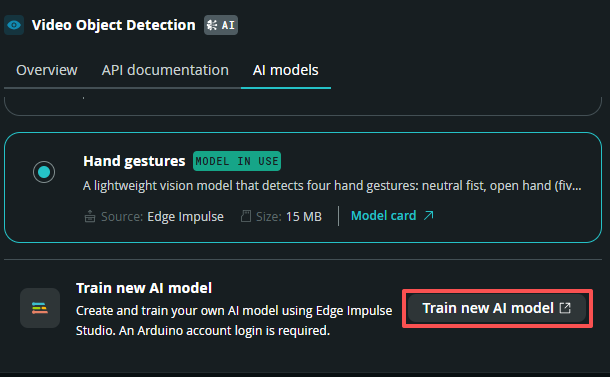
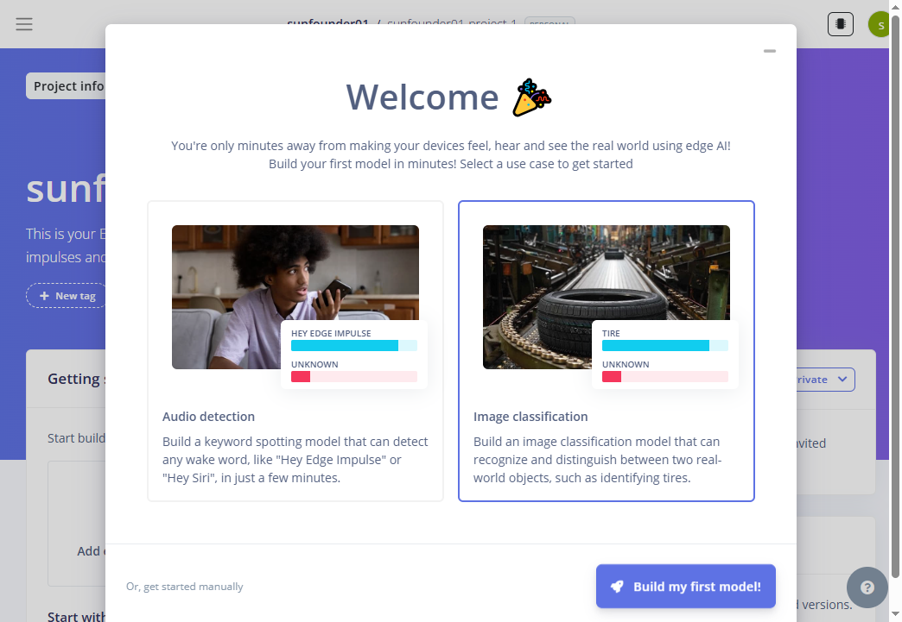
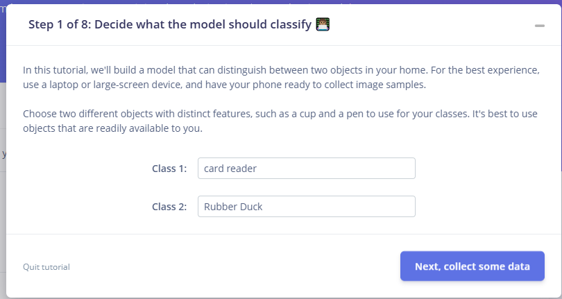
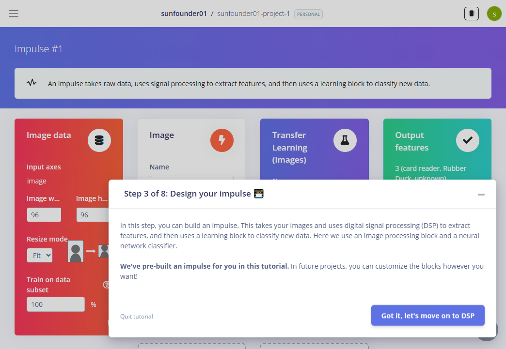
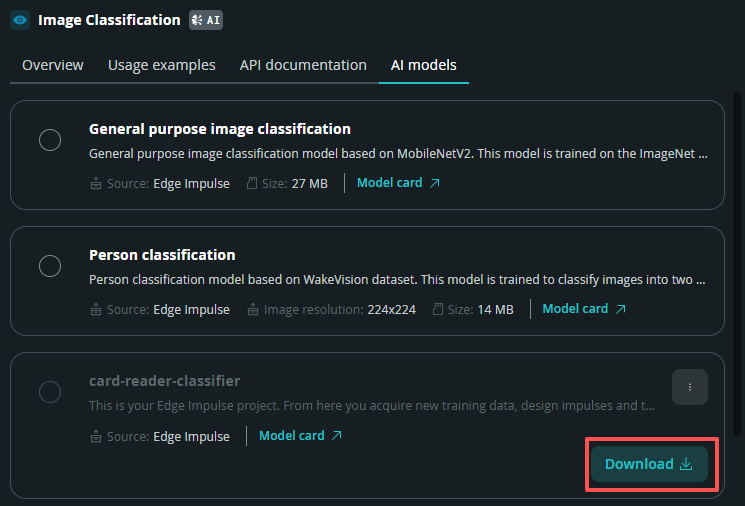

.. include:: /index.rst
   :start-after: start_hello_message
   :end-before: end_hello_message

09 Train Your Own AI Model
==========================

Every model you have used so far was trained by somebody else. The board recognized cups and people because Arduino had already shown a computer thousands of photos of cups and people. In this lesson you take that job over: you decide what the camera should recognize, collect the photos yourself, train the model in the cloud, and then run the app that uses it — **without changing a single line of code**. By the end, the "brain" in your UNO Q is one you built.

.. image:: img/09_train_your_own_model.png
   :width: 600

In this lesson, you will learn to:

* See what makes a model different from a program: nobody writes the rules, they come out of your examples
* Collect and label an image dataset for objects you care about
* Train an image-classification model in **Edge Impulse Studio** and read its training results
* Download your model in App Lab and select it for a brick, with no code change
* Judge a model by its confidence, its weak spots, and its speed on the board

1. Setup
--------

**What You Need**

.. list-table::
   :widths: 25 25
   :header-rows: 0

   * - 1 * :ref:`Pan Tilt Kit <pan_tilt_kit>`
     - 1 * USB-C Cable
   * - |list_pan_tilt|
     - |list_usb_cable|

**Software Requirements**

This project uses the following Bricks:

* Bricks (declared in ``app.yaml``):

  * ``video_image_classification`` — runs whichever image-classification model is selected in its Brick Configuration, so the same app works before and after you train your own
  * ``web_ui`` — serves the Web UI and keeps it updated over Socket.IO

Two more things are needed, and neither of them is software you install:

* An **Arduino account** — free, and it doubles as your Edge Impulse Studio login
* An **internet connection** — the model is trained on Edge Impulse's servers, not on the board

.. note::

   Before using the camera, make sure external carriers are enabled on your UNO Q — this is a one-time setup: :ref:`enable_external_carriers`.

No breadboard wiring is needed here. The CSI camera is already built into the AVIO Carrier, and everything in this lesson happens inside App Lab and your browser.

2. Train Your Own Model
-----------------------

This is the heart of the lesson: you are going to teach the board a class of object that no general model knows. The example below trains two of them — a **card reader** and a **rubber duck** — but any two objects with clearly different shapes will do.

.. note::

   Training happens on Edge Impulse's servers. The free plan is enough for everything in this lesson, and your Arduino account signs you in — there is no second account to create.

**Get the app onto the board**

The training button lives inside a brick, and bricks live inside apps — so the app has to exist before you can train. That is the only reason these two steps come first; you will run the app itself in the next section.

#. Download :download:`09 Train Your Own AI Model.zip <https://github.com/sunfounder/unoq-ai-kit/releases/latest/download/09.Train.Your.Own.AI.Model.zip>`.
#. In App Lab, go to **Apps** → **Create new app** → **Import App** → **Import from Computer**, and open the package you downloaded.

**Open the brick's AI models tab**

In App Lab, open the **Video Image Classification** brick and switch to its **AI models** tab. The list shows the models already available on your board, and a row to train a new one. Click **Train new AI model**.

**Sign in and connect Edge Impulse**

#. App Lab asks you to sign in with your Arduino account, then to let it talk to your Edge Impulse account. Click **Arduino Sign in**.

   .. image:: img/ai_model_signin.png
      :width: 600

#. The Arduino sign-in page opens in your browser. Sign in with an account you already have, or create one — the same account is your Edge Impulse login, so there is nothing else to register.

   .. image:: img/ai_model_signin_now.png
      :width: 320

#. Once you are signed in, the second step unlocks — click **Connect to Edge Impulse Studio**.

   .. image:: img/ai_model_connect_edge.png
      :width: 600

#. App Lab confirms that **Your Arduino Account is now connected to Edge Impulse** 🎉. Click **Start to Train your AI model** and your browser opens Edge Impulse Studio with a fresh project waiting for you.

   .. image:: img/ai_model_start_train.png
      :width: 600

**Set the target device**

Edge Impulse tunes and measures a model for one particular board, so it has to know which board you are building for. Set that before you design anything, while the project is still empty.

#. Look at the top-right corner of the Edge Impulse window. It shows the current target, for example **Target: Raspberry Pi 5**.
#. Click it to open **Configure your target device and application budget**.
#. Set **Target device** to **Arduino UNO Q (Qualcomm QRB2210)** and click **Save**.

   .. image:: img/ai_model_target.png
      :width: 640

.. note::

   The target is what makes **Arduino UNO Q** available as a deployment later. Leave it on another board and there is nothing for App Lab to download — which is exactly where models go missing.

**Name the project**

Edge Impulse names a new project after your account and a number, such as ``sunfounder01-project-1``. That name is what App Lab shows in its model list later, so give it something you will recognise.

#. Open the **Project info** page and rename the project after what it recognises — for example ``card-reader-classifier``.

   .. image:: img/ai_model_project_name.png
      :width: 640

**Choose what kind of model you want**

.. note::

   **Why this lesson trains a classification model.** Every lesson so far ran a
   detection model, which draws a box around each object it finds. A
   classification model answers for the whole picture instead: it names what it
   sees, and two identical objects still give one answer. That is the model the
   guided tutorial can teach you in minutes, because each training picture needs
   only one label — no boxes to draw. Train a detection model when you need to
   know how many objects there are, or where they are.

Edge Impulse opens on a welcome screen and asks you to choose a use case. Pick **Image classification** — *"build a model that can recognize and distinguish between two real-world objects"* — and click **Build my first model!**.

From here the work happens inside an **eight-step guided tutorial**, so you always know where you are and what to press. You are on **Step 1 of 8**.

**Name your two classes**

Step 1 of the tutorial asks what the model should classify. Type the two objects you have in front of you — ``card reader`` and ``Rubber Duck`` in this example — and click **Next, collect some data**.

Two things matter here. Give the classes **short, distinct names**, and choose objects that look clearly different from each other: telling a black card reader from a black remote control is a much harder job than telling it from a yellow duck.

**Collect thirty pictures of each class**

#. Step 2 of the tutorial turns your phone into the camera. Scan the QR code on screen with your phone's camera app.

   .. image:: img/ai_model_impulse_qrcode.png
      :width: 600

#. The page that opens asks for permission to use the camera — tap **Give access to the camera**.

   .. image:: img/ai_model_mobile_camera.png
      :width: 400

#. You are now collecting data. The page shows the class you are working on, how many pictures are still missing, and a **Capture** button: put the object in the frame and take the picture.

   .. image:: img/ai_model_card_capture.png
      :width: 400

#. Take **30 pictures per class**, and make them as different from one another as you can. The tutorial asks for exactly this — *"take pictures of the same object(s) at different angles and with different backgrounds"*:

   * at different angles — from above, from the side, upside down
   * at different distances — close up and across the table
   * in different light — daylight, lamp, shadow
   * on different backgrounds — table, floor, your hand
   * with other things in the frame, so the model learns what to *ignore*
   
   When the counter reaches **30 of 30 collected**, the phone shows a green tick and tells you to go back to the tutorial screen.

   .. image:: img/ai_model_card_finish.png
      :width: 400

#. Back on the computer, the pictures you just took are listed under the class name — this strip is the **card reader** set.

   .. image:: img/ai_model_card_reader.png
      :width: 600

#. Then collect the second class the same way. The phone switches to **Rubber Duck** by itself once the first class is full.

   .. image:: img/ai_model_rubber_collect.png
      :width: 400

#. Edge Impulse has also added a third class called **unknown**, and it wants thirty pictures of that one too. This is not your object — it is everything else: the keyboard, the desk, the ceiling, your hand. It is what teaches the model to answer *"this is neither of my two objects"* instead of being forced to guess.

   .. image:: img/ai_model_others_collect.png
      :width: 400

#. When all three classes read **30 of 30**, the **Dataset** page lists **90 items** in total and the tutorial unlocks its next step. Click **Next, create an impulse**.

   .. image:: img/ai_model_all_collect.png
      :width: 600

**Design the impulse**

An **impulse** is the pipeline your pictures travel through: an input block, a processing block that extracts useful features, and a learning block that does the classifying. Step 3 of the tutorial has already designed one for this model, and the panel behind the dialog shows the four parts:

* **Image data** — the input, resized to **96x96** pixels
* **Image** — the processing block that turns pixels into features
* **Transfer Learning (Images)** — the learning block: a small neural network already trained on a large image collection, now fine-tuned on your 90 pictures
* **Output features** — three labels: ``card reader``, ``Rubber Duck``, ``unknown``

Click **Got it, let's move on to DSP**.

.. note::

   This tutorial designs the impulse for you. When you design one yourself, those
   same blocks are yours to choose. For a classification model the learning block
   stays **Transfer Learning (Images)**, and the two settings worth knowing are the
   **image size** — 96x96 is plenty for two objects and runs fastest on the board —
   and the number of **training cycles**, which you meet in the next step.

   A **detection** model uses an **Object Detection (Images)** learning block instead,
   and it needs a box drawn around every object in every training picture. That is the
   trade-off behind this lesson's choice: detection can tell you how many objects there
   are and where they are, classification cannot — and classification is far quicker
   to build, which is why the guided tutorial teaches it.

Designing the blocks yourself is the next step up: Edge Impulse's own `Image classification <https://docs.edgeimpulse.com/tutorials/end-to-end/image-classification>`_ tutorial walks through the same processing and transfer-learning blocks by hand, with more detail on the settings.

**Train the model**

Edge Impulse runs the next three steps **for you**: the tutorial walks you through them with a **Next** button, and there is nothing to configure or decide.

#. The image block processes the training pictures.
#. The features are generated — the numeric form the network learns from.
#. The network is trained. This is the part that runs on Edge Impulse's servers and takes a few minutes.

If you clicked through this part quickly, that is fine — the model that comes out of it is the proof that these steps ran.

Training gives you two numbers to watch: **accuracy** should climb and **loss** should fall. If the curves flatten out early, fewer cycles are enough; if they are still improving at the end, raise the number and train again. If your model is perfect on the training pictures but fails on the real thing, turn on **Data augmentation** — it feeds the model slightly warped copies of every image so it learns shapes instead of memorising pixels.

**Take your model for a spin**

#. Once training finishes, Step 7 of the tutorial hands the model back to your phone. Scan the QR code it shows.

   .. image:: img/ai_model_spin.png
      :width: 600

#. Now point the phone at each object in turn. The phone runs your model on its live camera image and prints the decision underneath.

   .. image:: img/ai_model_train_finsh.png
      :width: 600

   Three things in those panels are worth reading carefully, because they are the whole point of the lesson:
   
   * **card reader (1.00)** and **Rubber Duck (1.00)** — the model is certain, and it is right. Those decimals are the confidence it learned from your thirty pictures each.
   * **unknown (0.96)** when you point it at something else — and this is the class that keeps the app honest. Without it, the model would have been forced to choose between your two objects every single time, and a wall would have been called a rubber duck.
   * **Time per inference: 2 ms** — at 96x96 this model is fast enough to run many times per second on the UNO Q, which is exactly what a live camera feed needs.

When a class keeps coming back wrong, the fix is almost always **more pictures rather than more training**: go back to Step 2 of the tutorial, collect a few more angles, and train again. Click **View summary to finish tutorial** when you are done with the phone — the model is already saved to your Edge Impulse account.

**Deploy the model to the UNO Q**

The model looks right on the phone, so let App Lab use it now. It lives inside your Edge Impulse account, App Lab never reads that account — it reads the **deployments** you publish from it. This step is what actually hands the model over, and skipping it is the most common reason a finished model never appears in App Lab.

#. In the left sidebar, click **Deployment**.
#. Under **Deployment target**, choose **Arduino UNO Q**.

   .. image:: img/ai_model_deployment.png
      :width: 700

#. Leave the optimisation as it is and click **Build**. The build runs in Edge Impulse's cloud and takes a minute or two.
#. When the **Built Arduino UNO Q model** dialog appears, click **Go to Arduino**. That button is what tells App Lab the model is ready.

.. note::

   The model is now stored twice: trained in your Edge Impulse account, and built as a deployment for this board. Later on you can retrain, build again, and download the new version without touching the app.

**Download the model in App Lab**

Back in App Lab, your new model now appears in the brick's **AI models** list, next to the built-in ones, marked as coming from **Edge Impulse**. Click **Download** on it — App Lab fetches the deployment and copies it to the board. (An older App Lab labels this button **Install**.)

.. note::

   **A model only appears in the brick that can run it.** Edge Impulse builds classification and detection models differently, and a brick accepts only one of the two:

   .. list-table::
      :header-rows: 1
      :widths: 30 35 35

      * - What you trained
        - Learning block in Edge Impulse
        - Brick that runs it
      * - **Image classification**
        - ``Image`` + ``Transfer learning (Images)``
        - ``image_classification``, ``video_image_classification``
      * - **Object detection**
        - ``Image`` + ``Object detection (Images)``
        - ``object_detection``, ``video_object_detection``

   If your model is missing from a brick's list, check this first, then the target and the deployment above.

Then select it, so that it is the model **in use** — the card marked *in use* is the one the brick actually runs. To go back to the built-in model later, select that card instead; **Brick Configuration** shows the same choice in one place. Nothing in the app has to change: no file in this project names a model, which is exactly why the same app runs the built-in model and yours.

The trained model arrives as a single ``.eim`` file (an **Edge Impulse Model**) that holds both the architecture and the learned parameters. You can train as many as you like and switch between them in Brick Configuration.

3. Run the App
--------------

#. With your model selected, click the **Run** button (▶). The app boots the camera and loads the model on the board, which takes a few seconds the first time.

   .. image:: /img/app_run.png
      :width: 500

#. Open the **Web UI** tab. On the left is the live camera feed; on the right, **what the model sees right now** — each label with a confidence bar — plus a running total for every class it has recognized since the app started. Hold your object in front of the camera and watch it appear with its own confidence bar and its own row in the totals.

Because this is a classification model, one answer describes the whole frame: it says *what* the picture shows, not how many objects are in it. Two identical objects still give one result — the per-class totals count how often each class won, not how many objects were in view.

.. image:: img/09_train_your_own_model.png
   :width: 600

Nothing in the code changed between importing the app and this run: the brick simply runs whichever model is selected in its **Brick Configuration**. Switch back to the built-in general model there at any time and the same app reports everyday objects again.

**How it Works**

An App Lab project is a folder containing multiple files. Here's what each one does:

* ``09 Train Your Own AI Model/`` — the app folder

  * ``app.yaml`` — App metadata: declares the ``video_image_classification`` and ``web_ui`` bricks. The package names no model; App Lab writes the one you pick into this file
  * ``python/``

    * ``main.py`` — counts what the model reports and pushes a snapshot to the browser
  * ``sketch/``

    * ``sketch.ino`` — idle: every part of this project runs on the Linux MPU
  * ``assets/``

    * ``index.html`` — Web UI structure (camera frame, live list, totals, counters)
    * ``app.js`` — Browser logic: camera stream and Socket.IO events
    * ``style.css`` — Visual styling
    * ``libs/`` — JavaScript libraries (Socket.IO)
    * ``img/`` — Static resources

  * ``README.md`` — Project documentation and usage guide

The data path from a frame to the panel on screen:

.. mermaid::

   sequenceDiagram
       participant C as Camera (CSI)
       participant V as Brick (video_image_classification)
       participant P as Python (main.py)
       participant B as Browser (HTML/JS)

       C->>V: frame (flipped vertically)
       V->>V: run the selected model on the frame
       V->>P: on_detect_all({label: confidence})
       P->>P: add to per-class totals, keep the latest label
       P-->>B: model_report {objects, totals, session}
       B->>B: draw the list, bars and counters
       B->>V: live video from port 4912 (/embed)

Here's what each component does:

**Camera (peripheral)** — the same CSI camera as the earlier lessons
  * ``Camera(adjustments=lambda frame: frame[::-1, :])`` flips every frame vertically, because the camera is mounted upside down on the carrier
  * The brick analyses those frames; the video you see in the browser is the brick's own stream on port **4912**

**Brick (video_image_classification)** — runs on the Linux MPU
  * ``VideoImageClassification(camera, confidence=0.4, debounce_sec=0.5)`` runs the model selected in **Brick Configuration** — nothing in the code names one
  * ``on_detect_all(callback)`` hands Python a dictionary on every analysed frame: the keys are class names and the values are how confident the model was in that frame

**Python (main.py)** — runs on the Linux MPU
  * ``report()`` adds each frame's label to ``session_totals``, a running count of how often each class won
  * ``snapshot()`` builds one dictionary holding the current list, the totals, the session clock and the number of classes seen

**Browser (HTML/JS)** — runs in your browser
  * The camera feed is an ``<iframe>`` pointed at the brick's stream on port 4912 (``/embed``)
  * ``socket.on("model_report", …)`` redraws the live list, the per-class totals and the three counters

4. Experiment
-------------

**Put Your Model to Work**

Move your object in front of the camera and watch the panel.

.. list-table::
   :header-rows: 1
   :widths: 45 55

   * - You do
     - What you see
   * - Show the object clearly, filling the frame
     - High confidence, usually above 80%
   * - Move it further away or to the edge
     - Confidence drops, and the object may disappear from the list
   * - Turn the lights down
     - The model gets less certain if your dataset was shot in bright light
   * - Put the object on a background it never saw
     - The model may hesitate, or call it something else
   * - Bring in a second object you trained
     - The model names the one it is most sure of: a classification model gives one answer for the whole frame
   * - Show something you never trained
     - Ideally it drops to ``unknown`` — the third class the tutorial had you collect

**Challenge:** Watch the per-class totals for a minute of normal use. Which class piles up even when it is not in front of the camera? That number is your model's weak spot, and it tells you exactly which photos are missing from your dataset.

**Add a third class of your own.** Go back to **Data acquisition**, collect thirty pictures of another object and thirty more for ``unknown``, run the impulse again, build a new **deployment** and download it in App Lab. Watch what the ``unknown`` total does now that the model has three objects to choose between.**

5. Troubleshooting
------------------

**"Train new AI model" is missing, or signing in fails**

* **Cause:** You are not signed in to an Arduino account, or the board has no internet connection.
* **Solution:** Sign in from the App Lab account menu first, then reopen the brick's **AI models** tab.

**The model never reaches App Lab, in any brick**

* **Cause:** The impulse finished training but was never **built as a deployment** for the UNO Q, or the project's target is still another board.
* **Solution:** In Edge Impulse, set **Target device** to **Arduino UNO Q (Qualcomm QRB2210)**, then open **Deployment**, choose **Arduino UNO Q**, click **Build**, and finish on **Go to Arduino**.

**Your model never shows up in the brick's list**

* **Cause:** The training was never finished, or the model was not installed.
* **Solution:** In Edge Impulse Studio, let the training step finish completely.

6. Summary
----------

You just did what used to take a machine-learning team: you collected a dataset, trained a model, and put it on a device that fits in your hand. In this lesson, you learned:

* What an AI model is — a trained "brain file" you can swap, not a program you write
* How the Edge Impulse pipeline works: collect, label, design, train, test, deploy
* How to install a custom model in App Lab and select it for a brick
* How to read confidence, class totals and inference speed to judge a model
* Why the quality of your dataset matters more than the size of your network

Every lesson in this module so far used somebody else's model. Now the UNO Q can recognize whatever you decide to teach it — and the next time your project needs to see something new, you know exactly which workflow to reach for.
