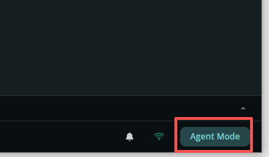
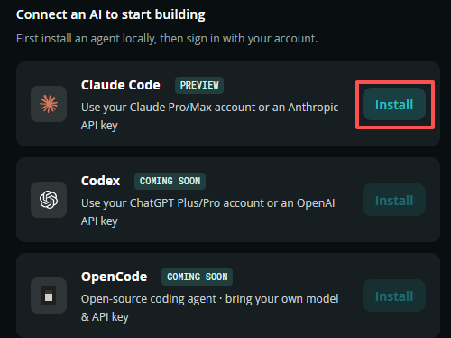
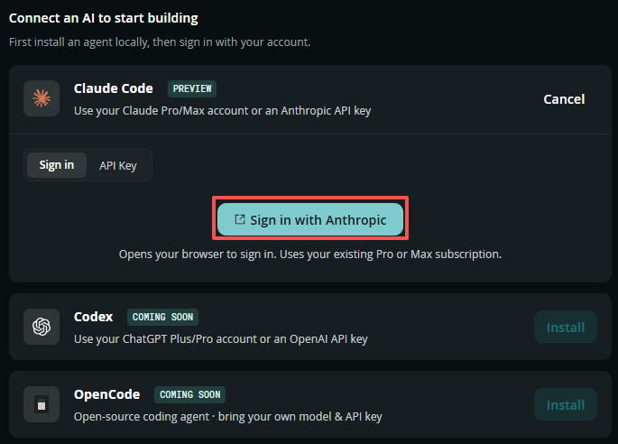
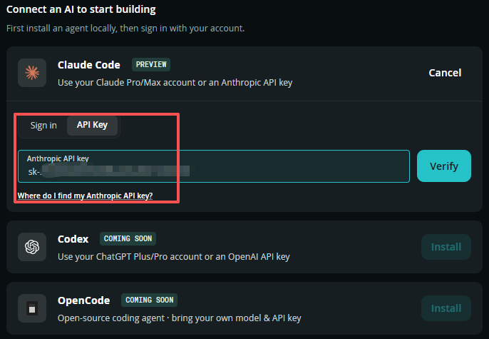

.. include:: /index.rst
   :start-after: start_hello_message
   :end-before: end_hello_message

.. _ai_agent:

The App Lab AI Agent
====================

Arduino App Lab 0.10 added **Agentic Mode** — an AI agent that works *on* your project instead of only talking about it. You describe what you want, and it reads your app, creates and edits files, runs the app, stops it when something goes wrong, and explains the error it found. Apps, Bricks, and Sketches are part of what it understands, so it can set a brick up for you instead of leaving you to find the right menu.

.. note::

   The agent is an **optional extra**, not a required part of this course — every lesson in this kit can be completed without it. It is also a different thing from the AI *lessons* in the modules, where the program you build talks to a model as part of the project.

**What it needs**

* **Arduino App Lab 0.10 or newer.** App Lab updates itself. If you have it installed, the newest release arrives the next time you open the app.
* **An account with a supported AI agent.** The agent is **bring-your-own-account**: App Lab installs the agent locally and you sign in with your own subscription or API key, so your usage is billed to you and not to SunFounder. At the time of writing the panel offers three agents, and only the first is available:

  * **Claude Code** — *preview* — a **Claude Pro/Max subscription** or an **Anthropic API key**
  * **Codex** — *coming soon* — a **ChatGPT Plus/Pro account** or an **OpenAI API key**
  * **OpenCode** — *coming soon* — an open-source agent that takes any model and API key

* **A board connected, with an app open.** The agent edits whichever app is open in App Lab.

Open Agent Mode
---------------

#. Open **Arduino App Lab** and open the app you want to work on.
#. Click **Agent Mode** in the bottom-right corner of the window. A panel opens that asks you to **connect an AI to start building**.

#. Install **Claude Code**: click **Install** next to it and let App Lab set the agent up locally. The other two entries are marked **COMING SOON** and their buttons stay disabled until Arduino enables them.

#. Connect your account. There are two ways, and the panel keeps both on separate tabs:

   * **Sign in** — click **Sign in with Anthropic**. Your browser opens so you can sign in, and the agent uses your existing **Pro or Max subscription**.
   * **API Key** — paste an **Anthropic API key** and click **Verify**. Use this when you pay per use instead of holding a subscription; the *Where do I find my Anthropic API key?* link in the panel explains where to create one.

Once an agent is connected, the session panel is where you work: describe the change you want in plain language, and watch the agent edit the project. It lists the files it touches, writes the changes into your app, and can start the app to see whether its own work runs — then read the error and try again if it does not.

.. note::

   **This is the step where the course cannot help you.** Every lesson in this kit runs without the agent, and the agent itself needs an account that only you can open — an Anthropic subscription or key today, or a ChatGPT/OpenAI account once **Codex** leaves *coming soon*. If you do not have any of them, skip this page and go straight to the lessons: you lose a helper, not a lesson.

Writing a good request
----------------------

The agent does best when you describe the **outcome** rather than the implementation. The rules are the same ones that make a good prompt anywhere else:

.. list-table::
   :header-rows: 1
   :widths: 45 55

   * - Ask for this
     - Instead of this
   * - *"Add a slider to the Web UI that sets the LED brightness."*
     - *"Write some JavaScript."*
   * - *"Use the camera brick and show the frames in the Web UI."*
     - *"Make a camera app."*
   * - *"The app starts but the LED never turns off — find out why and fix it."*
     - *"It doesn't work."*
   * - *"Change the header colour to the one the other lessons use."*
     - *"Make it look better."*

If a change goes the wrong way, do not start over: tell the agent what you saw — the error text, or what the board did instead — and let it correct itself. That loop is the whole point of an agent.

Where it is strong, and where it is not
---------------------------------------

* **Strong:** scaffolding a new app, wiring a brick up correctly, browser boilerplate, reading a stack trace and turning it into a fix, and knowing the shape of an App Lab project.
* **Strong:** work you can check. Run the app after every change and watch the board — the agent cannot see the LED, the servo, or the camera, so you are the sensor.
* **Weaker:** anything that depends on the physical kit in front of you (which pin is free, how the servo is mounted), and anything where "correct" is a matter of taste rather than the code running.
* **Finish by reading the code.** The agent writes it, but the project is still yours: an app you cannot explain is an app you cannot change later.
* **Watch the cost.** Your account is billed for the agent's work, so short, specific requests are cheaper and usually better.

For Arduino's own introduction, including a demo of the agent at work, see the `Arduino App Lab 0.10 release notes <https://docs.arduino.cc/software/app-lab/release-notes/release-0-10/>`_.
