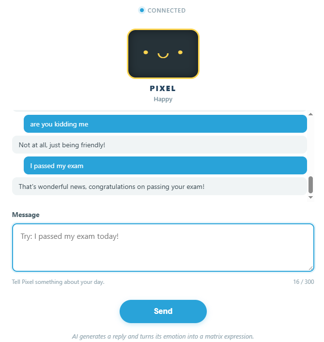

.. include:: /index.rst
   :start-after: start_hello_message
   :end-before: end_hello_message

02 AI Digital Pet
=================

In the previous project the model could only ever say one word — a colour — and your code did the rest. Now the model has to keep two promises at once: hold up its end of a conversation in a friendly sentence, *and* name the mood behind that sentence. You type a message to **Pixel**, your AI pet, the words appear in the chat, and a moment later the pet's face appears on the UNO Q's built-in LED matrix.

In this lesson, you will learn to:

* Get one answer from a model that carries two pieces of information — the words and the mood
* Write a **system prompt** that demands a strict, machine-readable reply, and then parse that reply without trusting it
* Turn a mood word into a face with a lookup table, a Bridge call, and the board's built-in 8 × 13 LED matrix
* Fall back safely when the model answers with something your code cannot read, so the pet is never left blank
* See the pattern *the model decides, the code enforces* applied to something that is not just hardware — it is personality

1. Setup
--------

**What You Need**

.. list-table::
   :widths: 25 25 25 25
   :header-rows: 0

   * - 1 * Pan Tilt Kit
     - 1 * :ref:`cpn_uno_q`
     - 1 * USB-C Cable
     -
   * - |list_pan_tilt|
     - |list_uno_q|
     - |list_usb_cable|
     -

**Software Requirements**

This project uses two App Lab **Bricks** — support packages that App Lab adds to your app for you:

* ``web_ui`` — serves the pet page and carries messages between the browser and Python
* ``cloud_llm`` — sends your message to a cloud language model and streams the answer back

Because the model is reached over the internet, the project needs a key of your own. ``app.yaml`` declares the ``cloud_llm`` brick with an empty ``API_KEY``, so App Lab asks you for an **OpenAI API key** the first time you press **Run** and stores it for you.

The sketch declares no libraries of its own in ``sketch.yaml``. The two headers it uses — the Bridge library and the LED matrix library — ship with the UNO Q core, so there is nothing to install.

No breadboard wiring is needed in this lesson — the pet's face is drawn on the LED matrix that is already part of the UNO Q, so there is nothing to connect before you run the app.

.. note::

   The first time you run this project, App Lab asks for your **OpenAI API key**, because the app uses the ``cloud_llm`` brick to reach the model. Paste a key from your OpenAI account and save it — App Lab keeps the key for your board, so you only do this once.

2. Run the App
--------------

#. Download :download:`02 AI Digital Pet.zip <https://github.com/sunfounder/unoq-ai-kit/releases/latest/download/02.AI.Digital.Pet.zip>`.
#. In App Lab, go to **Apps** → **Create new app** → **Import App** → **Import from Computer**, and open the package you downloaded.
#. Click the **Run** button (▶) in the top-right corner. The sketch draws a neutral face on the LED matrix, then the Python side starts the Web UI.

   .. image:: /img/app_run.png
      :width: 500
      :align: center

The **Web UI** tab opens by itself — the next section walks through what to do with it.

**How it Works**

Here is the whole path a message travels — out of your browser, into the cloud, and back down to a face on the matrix.

An App Lab project is a folder of files. Here is what is inside this one:

* ``02 AI Digital Pet/`` — the app folder

  * ``app.yaml`` — app metadata: name, icon, and the two Bricks the project declares
  * ``README.md`` — a short guide to the project

  * ``python/``

    * ``main.py`` — the chat handler, the cloud model request, the reply parser, and the Bridge call

  * ``sketch/``

    * ``sketch.ino`` — the five faces, the emotion switch, and the Bridge function
    * ``sketch.yaml`` — sketch configuration for the UNO Q board

  * ``assets/``

    * ``index.html`` — the pet page: status row, face preview, message list, and input box
    * ``app.js`` — browser logic: sending your message, drawing the replies, swapping the face
    * ``style.css`` — the visual styling of the page
    * ``libs/socket.io.min.js`` — the Socket.IO client that carries messages between the page and the board
    * ``img/sf_logo.png`` — the logo in the page header
    * ``docs_assets/`` — the result image used by this documentation

The data path, from a typed message to a face on the matrix:

.. mermaid::

   sequenceDiagram
       participant B as Browser (HTML/JS)
       participant P as Python (main.py)
       participant L as Cloud LLM (OpenAI)
       participant S as Sketch (sketch.ino)

       B->>P: socket.emit("message", {text})
       P->>S: Bridge.call("show_emotion", 4)
       P->>L: CloudLLM.chat_stream(message)
       L-->>P: {"emotion":"happy","reply":"..."}
       P->>P: parse_pet_response - JSON and emotion check
       P->>S: Bridge.call("show_emotion", 1)
       P-->>B: socket.emit("response", {emotion, reply})
       B->>B: setEmotion("happy") and the reply joins the chat

Here is what each piece does:

**Sketch (sketch.ino)** — runs on the STM32 MCU
  * ``setup()`` starts the display with ``matrix.begin()``, sets ``matrix.setGrayscaleBits(3)``, clears the grid, and draws the neutral face
  * Each of the five faces is a 104-value brightness array — 8 rows of 13 columns — painted with ``matrix.draw()``

**Python (main.py)** — runs on the Linux MPU
  * ``WebUI()`` starts the server that hands the pet page from ``assets/`` to your browser
  * ``ui.on_message("message", handle_message)`` listens for the sentence the page sends

**Cloud LLM (behind the ``cloud_llm`` brick)** — runs on OpenAI's servers
  * The **system prompt** names the pet (Pixel), lists the five emotions, and asks for *only* JSON in the shape ``{"emotion":"happy","reply":"..."}``, with no Markdown and nothing outside the braces
  * Your sentence is sent with that instruction over the internet, and the answer comes back as one JSON object

**Bridge** — the channel between the MPU and the MCU
  * Sketch side: ``Bridge.provide("show_emotion", show_emotion)`` exposes the face function
  * Python side: ``Bridge.call("show_emotion", code)`` invokes it with one integer

**Browser (HTML/JS)** — runs in your browser
  * ``socket.emit('message', {text})`` sends what you typed; the **Send** button and the Enter key both call ``sendMessage()``
  * ``socket.on('pet_status', ...)`` switches the face preview to *thinking* the instant your message leaves

Notice that the model answers with two things at once, and they are not equally trustworthy. The words go straight to the screen because they are only text; the mood has to survive ``json.loads()`` and a lookup table before it is allowed anywhere near the hardware.

3. Experiment
-------------

**Give Pixel Something to React To**

The pet answers in words and in mood at the same time, so you can watch both halves of its decision. Type these and compare the sentence in the chat with the face on the matrix:

.. list-table::
   :header-rows: 1
   :widths: 45 55

   * - What you type
     - What happens
   * - *"I passed my exam today!"*
     - The words and the mood travel together — the reply sounds pleased and the happy face appears
   * - *"My dog is sick."*
     - The reply turns sympathetic and the sad face appears
   * - *"Guess how many brothers I have."*
     - The model treats it as a question and usually reaches for the thinking face
   * - *"I just saw a shooting star!"*
     - Surprise is the closest of the five moods, so the surprised face appears
   * - *"What did you do today?"*
     - A plain answer with no strong feeling — neutral is the safe choice
   * - *"Tell me a long story about a robot dog."*
     - The pet is built for one short sentence, so the answer stops well before the story gets going

4. Troubleshooting
------------------

**The chat replies "Please configure your API Key and try again."**

* **Cause:** The request to the cloud model failed.
* **Solution:** Check the board's internet connection first, since the model lives in the cloud.

**The reply appears in the chat but the face on the matrix never changes**

* **Cause:** The Bridge call is not reaching the sketch, or the app's two halves did not start together.
* **Solution:** Watch the matrix while the app starts — the sketch draws the neutral face before Python is ready, which proves the grid and the sketch are alive.

**Pixel always answers "I am here with you." and keeps a neutral face**

* **Cause:** ``parse_pet_response()`` could not read the model's answer.
* **Solution:** This is the fallback doing its job: the pet stays polite and visible instead of going blank.

5. Summary
----------

You just gave your UNO Q a personality. Your message goes out as plain English and comes back as two things at once: a sentence you can read and a mood the board can act on.

* Asking for **JSON** in the system prompt is what turns a chatty model into a part your code can wire up
* ``parse_pet_response()`` treats the answer as untrusted input — it strips code fences, finds the braces, and validates the mood against a lookup table
* Every failure path still produces a face and a sentence, so the pet degrades politely instead of going dark
* ``Bridge.call("show_emotion", code)`` carries one integer across to a ``switch`` that picks one of five 8 × 13 patterns
* A single model answer can now drive two different outputs — text for the screen and a value for the hardware

So far the model only knows what you tell it. In the next project the board starts feeding it facts of its own: live temperature, humidity, and light readings travel up from the sketch to the model, and the AI turns them into practical advice about the room you are sitting in.
