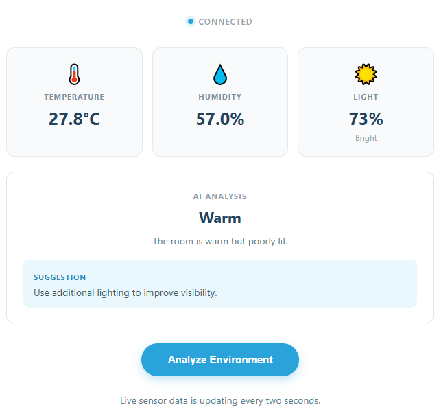

.. include:: /index.rst
   :start-after: start_hello_message
   :end-before: end_hello_message

03 AI Environment Advisor
=========================

So far the board has always answered the same question: *what is the number right now?* A slider value, a temperature, a light reading — your code measured it and your page printed it. This project adds the missing half. The DHT11 and the photoresistor you have already used take the measurement, and a **large language model** reads those three numbers as a description of a room, decides whether the room is comfortable, warm, humid, dark, or something in between, and writes a short sentence of practical advice next to it.

In this lesson, you will learn to:

* Send live sensor readings — not just a sentence you typed — to a large language model
* Ask the model for a **structured answer**, so the reply arrives as fields your page can place instead of a paragraph it has to guess at
* Guard that answer on your own side: check the status against a known list, and fall back to something safe when the reply cannot be read
* Follow a third kind of Bridge call, where the sketch pushes data to Python with ``Bridge.notify()`` instead of waiting to be asked
* See the difference between a **measurement** (the number the sensor gives) and an **interpretation** (what that number means for a person in the room)

1. Setup
--------

**What You Need**

.. list-table::
   :widths: 25 25 25 25
   :header-rows: 0

   * - 1 * Pan Tilt Kit
     - 1 * :ref:`cpn_humiture_sensor` (DHT11)
     - 1 * :ref:`cpn_photoresistor` (Photoresistor Module)
     - 1 * USB-C Cable
   * - |list_pan_tilt|
     - |list_dht11|
     - |list_photoresistor|
     - |list_usb_cable|
   * - Several :ref:`cpn_wires`
     -
     -
     -
   * - |list_wire|
     -
     -
     -

**Software Requirements**

This project uses two App Lab **Bricks** — support packages that App Lab adds to your app for you:

* ``web_ui`` — serves the advisor page and carries the live readings and the model's answer between the browser and Python
* ``cloud_llm`` — sends the reading summary to a cloud language model and streams the advice back

Because the model is reached over the internet, the project needs a key of your own. ``app.yaml`` declares the ``cloud_llm`` brick with an empty ``API_KEY``, so App Lab asks you for an **OpenAI API key** the first time you press **Run** and stores it for you.

The sketch needs two libraries, both declared in ``sketch.yaml`` and installed for you when the app is built:

* ``DHT sensor library (1.4.6)`` — the ``DHT`` class that reads temperature and humidity from the sensor
* ``Adafruit Unified Sensor (1.1.15)`` — the shared sensor interface that the DHT library is built on

The Bridge library that lets the sketch and Python talk to each other is part of the UNO Q core, so there is nothing else to install.

.. note::

   The first time you run this project, App Lab asks for your **OpenAI API key**, because the app uses the ``cloud_llm`` brick to reach the model. Paste a key from your OpenAI account and save it — App Lab keeps the key for your board, so you only do this once.

**Wiring Diagram**

The **DHT11** uses three pins — **DATA** to **D4**, **VCC** to **5V**, **GND** to **GND** — and the **photoresistor module** is wired the same way except for one thing that matters: its **VCC goes to 3.3V, not 5V**, and its signal pin goes to **A0**. A0 is wired straight to the STM32 analog input and tolerates about 3.6 V at most, so a light module fed from 5 V must never drive it — powering the module from 3.3 V keeps its output inside that limit. The light reading is a *relative* classroom measurement taken from the voltage on **A0**, so it depends on how the module is built: on most modules the percentage rises as the room gets brighter, but on a module whose resistor and photoresistor are swapped it will rise as the room gets darker instead. Compare the number with the room you are sitting in — if it moves the wrong way, that is the module, not a mistake in your wiring.

.. image:: /img/wiring/wiring_dht11_photoresistor.png
   :width: 500
   :align: center

2. Run the App
--------------

#. Download :download:`03 AI Environment Advisor.zip <https://github.com/sunfounder/unoq-ai-kit/releases/latest/download/03.AI.Environment.Advisor.zip>`.
#. In App Lab, go to **Apps** → **Create new app** → **Import App** → **Import from Computer**, and open the package you downloaded.
#. Click the **Run** button (▶) in the top-right corner. The sketch gives the DHT11 two seconds to settle, takes its first reading, and the Python side starts the Web UI.

   .. image:: /img/app_run.png
      :width: 500
      :align: center

The **Web UI** tab opens by itself — the next section walks through what to do with it.

**How it Works**

Here is the whole path a reading travels — from two sensors on the breadboard, up through Python to the cloud, and back to the page as advice.

An App Lab project is a folder of files. Here is what is inside this one:

* ``03 AI Environment Advisor/`` — the app folder

  * ``app.yaml`` — app metadata: name, icon, and the two Bricks the project declares
  * ``README.md`` — a short guide to the project

  * ``python/``

    * ``main.py`` — the live reading store, the prompt, the reply parser, and the model request

  * ``sketch/``

    * ``sketch.ino`` — the DHT11 and photoresistor code, the two-second timer, and the Bridge notifications
    * ``sketch.yaml`` — sketch configuration and the two libraries it needs

  * ``assets/``

    * ``index.html`` — the advisor page: status row, three sensor cards, analysis panel, and button
    * ``app.js`` — browser logic: live readings, the Analyze button, and drawing the model's answer
    * ``style.css`` — the visual styling of the page
    * ``libs/socket.io.min.js`` — the Socket.IO client that carries messages between the page and the board
    * ``img/sf_logo.png`` — the logo in the page header
    * ``docs_assets/`` — the result and wiring images used by this documentation

The data path, from a sensor voltage to a sentence of advice:

.. mermaid::

   sequenceDiagram
       participant S as Sketch (sketch.ino)
       participant P as Python (main.py)
       participant B as Browser (HTML/JS)
       participant L as Cloud LLM (OpenAI)

       S->>S: dht.readTemperature() and analogRead(A0)
       S->>P: Bridge.notify("environment_update", t, h, raw)
       P->>P: light_description(percent) and latest_environment.update()
       P-->>B: ui.send_message("sensor_update", latest_environment)
       B->>P: socket.emit("analyze_environment", {})
       P->>L: llm.chat_stream(message=prompt)
       L-->>P: {"status": "...", "summary": "...", "suggestion": "..."}
       P->>P: parse_analysis(raw_response) and VALID_STATUSES check
       P-->>B: ui.send_message("analysis_result", analysis)
       B->>B: analysisStatus / analysisSummary / analysisSuggestion

Here is what each piece does:

**Sketch (sketch.ino)** — runs on the STM32 MCU
  * ``setup()`` sets **A0** to an input, calls ``dht.begin()``, then calls ``Bridge.begin()`` so Python can be notified
  * After two seconds of settling time it takes the first reading immediately, so the page has data as soon as it opens

**Python (main.py)** — runs on the Linux MPU
  * ``WebUI()`` starts the server that hands the advisor page from ``assets/`` to your browser
  * ``Bridge.provide("environment_update", environment_update)`` registers the function the sketch notifies — the mirror image of the ``Bridge.call()`` you have used before

**Cloud LLM (behind the ``cloud_llm`` brick)** — runs on OpenAI's servers
  * The **system prompt** explains that the model is an environment advisor for a classroom, forbids medical certainty, and lists the eight statuses it may choose from
  * It also demands the answer arrive as JSON with exactly three fields — ``status``, ``summary``, and ``suggestion`` — with no Markdown and nothing outside the JSON

**Bridge** — the channel between the MCU and the MPU
  * Sketch side: ``Bridge.notify("environment_update", temperature, humidity, lightRaw)`` sends three values without being asked
  * Sketch side: ``Bridge.notify("sensor_error", ...)`` sends a message instead of readings when the DHT11 cannot be read

**Browser (HTML/JS)** — runs in your browser
  * ``socket.on('sensor_update', ...)`` writes the temperature, humidity, and light percentage into the three cards, and ignores any message where temperature or humidity is still ``null``
  * ``socket.on('connect')`` emits ``request_state`` so a page that opens late still gets the current readings immediately

Notice that the model never touches a pin. It receives three numbers that Python has already checked and labelled, and it returns three pieces of text that Python checks again before your page is allowed to show them.

3. Experiment
-------------

**Change the Room, Change the Advice**

The model only ever sees the snapshot you send it, so the fastest way to understand this project is to change the room and press **Analyze Environment** again. Keep the page open and watch both the sensor cards and the advice panel:

.. list-table::
   :header-rows: 1
   :widths: 40 60

   * - What you do
     - What the advice becomes
   * - Cover the photoresistor with your hand and wait for the light card to drop under 25
     - The light card reads **Dark** and the model's status is likely **Dark**, with a suggestion about turning on a lamp or opening the curtains
   * - Shine a phone torch at the photoresistor until the card passes 80
     - The card reads **Very Bright** and the status is likely **Bright**, with a suggestion about glare, shade, or saving energy
   * - Breathe warm air onto the DHT11 for a few seconds
     - The temperature climbs and the humidity jumps, and **Humid** becomes a likely status, with advice about ventilation
   * - Hold an ice pack or a cold drink near the DHT11 without touching it
     - The temperature falls and the status moves towards **Cold**, with advice about heating or a warmer layer
   * - Leave the room alone and press Analyze twice, a minute apart
     - The numbers barely move, so you often get the same status twice — proof that the model is answering the snapshot, not inventing a new opinion each time
   * - Cover the photoresistor and warm the DHT11 at the same time
     - The readings pull in different directions, and **Mixed** — the status the code also uses when a reply cannot be read — is a likely answer

4. Troubleshooting
------------------

**The sensor cards stay at "--.-°C" and the Analyze button never becomes clickable**

* **Cause:** The temperature is still ``null``, so Python is refusing to analyze anything.
* **Solution:** Give it a few seconds first — the first reading is taken on purpose after a two-second delay.

**The light percentage moves the opposite way to the real room**

* **Cause:** The percentage is calculated from the raw voltage on **A0**, and a photoresistor module is a voltage divider — which half of it the photoresistor sits in decides whether more light means a larger or a smaller reading.
* **Solution:** Shine a light at the module and watch the card.

**The panel says "Analysis unavailable" instead of an answer**

* **Cause:** ``llm.chat_stream()`` raised an exception, and the code shows the same message for every failure: no key saved yet, a key that was rejected or has run out of credit, or no internet connection on the board.
* **Solution:** Check the board's internet connection first, since the model lives in the cloud.

5. Summary
----------

You just gave your board a sense of judgement. The DHT11 and the photoresistor supply three honest numbers, Python turns them into a labelled snapshot, and a cloud model reads that snapshot and tells you what it means for the room you are sitting in — a measurement on one side, an interpretation on the other.

* A **structured answer** is what makes a model usable in a program: ask for named fields like ``status``, ``summary``, and ``suggestion``, and your page can place each one instead of searching through prose
* ``Bridge.notify()`` is the reverse of the Bridge calls you have used before — the sketch starts the conversation twice a second, and Python listens with ``Bridge.provide()``
* The body of the prompt is only three numbers, so every answer is tied to one moment and you can always see exactly what the model was shown
* ``parse_analysis()`` and ``VALID_STATUSES`` are your side of the bargain: strip the fences, pull out the JSON, and replace anything unrecognised with a safe fallback
* Python and the model do different jobs — the code decides what the light *is*, the model decides what it *means* — and neither one is allowed to do the other's work

The next project gives the model ears and a voice: you hold a button and speak into the microphone, speech recognition turns your words into text, the model replies, and the speaker reads that reply out loud so nothing has to appear on a screen at all.
