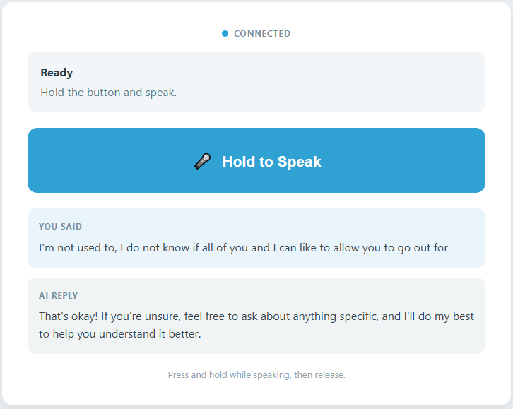

.. include:: /index.rst
   :start-after: start_hello_message
   :end-before: end_hello_message

04 AI Voice Assistant
=====================

Every project so far has taken its orders from a keyboard: a sentence typed into a box, a slider dragged with a mouse. This project takes the keyboard away. You hold a button on the page, **say a question out loud**, and the UNO Q turns your recording into text, sends that text to a cloud language model, and answers you in a voice of its own. Three different AI services cooperate in a single loop — and you never type a character.

In this lesson, you will learn to:

* Chain three AI services into one loop: **speech recognition**, a **cloud language model**, and **text to speech**
* Use **hold-to-talk** recording — audio is captured only between a button press and a release, and the page stays responsive while the answer is prepared
* Send your recording to an **online** speech service and get the words back — one OpenAI key covers both the recognition and the model
* Give the model a **system prompt** that decides how the assistant answers, and hear that decision in every reply
* Follow one spoken sentence through the status panel: Listening, Recognizing, Thinking, Speaking, Ready

1. Setup
--------

**What You Need**

.. list-table::
   :widths: 25 25 25 25
   :header-rows: 0

   * - 1 * Pan Tilt Kit
     - 1 * USB-C Cable
     - -
     - -
   * - |list_pan_tilt|
     - |list_usb_cable|
     - -
     - -

**Software Requirements**

This project uses four App Lab **Bricks** — support packages that App Lab adds to your app for you:

* ``web_ui`` — serves the hold-to-speak page and keeps the browser and Python in sync
* ``cloud_llm`` — sends the recognized sentence to a cloud language model and streams the answer back
* ``sunfounder_stt`` — turns your recording into text through an **online** speech service
* ``sunfounder_tts`` — turns the answer text into speech and plays it through the carrier's speaker

There is no sketch in this project and no sketch libraries to install: nothing here drives a pin, so every line of it runs in Python on the Linux MPU.

Because both the model and the speech service are reached over the internet, the project needs a key of your own. ``app.yaml`` declares ``cloud_llm`` and ``sunfounder_stt`` with empty key fields, so App Lab asks you for an **OpenAI API key** the first time you press **Run** and stores it for you — the same key works for both. The package you download stays small, because no speech model travels inside it: the recognition happens on OpenAI's servers. The ``cloud_llm`` brick also speaks to **Anthropic** and **Google** - see :ref:`llm_other_models` for the one line that changes.

No breadboard wiring is needed here: the ears and the voice belong to the AVIO Carrier, so the kit works exactly as it comes out of the box.

.. note::

   The first time you run a TTS example on this UNO Q, App Lab needs to download and prepare the TTS runtime and audio dependencies. This may take half an hour or more, depending on your network connection.

   The first time you run this project, App Lab asks for your **OpenAI API key**, because the app reaches both the model and the speech service over the internet. Paste one key into both fields and save it — App Lab keeps the key for your board, so you only do this once.

2. Run the App
--------------

#. Download :download:`04 AI Voice Assistant.zip <https://github.com/sunfounder/unoq-ai-kit/releases/latest/download/04.AI.Voice.Assistant.zip>`.
#. In App Lab, go to **Apps** → **Create new app** → **Import App** → **Import from Computer**, and open the package you downloaded.
#. Click the **Run** button (▶) in the top-right corner. The Output window prints *"AI Voice Assistant ready."*

   .. image:: /img/app_run.png
      :width: 500
      :align: center

The **Web UI** tab opens by itself — the next section walks through what to do with it.

**How it Works**

The whole project is one loop with three services in the middle: your voice goes in at one end, and the answer comes back out of the speaker at the other.

An App Lab project is a folder of files. Here is what is inside this one:

* ``04 AI Voice Assistant/`` — the app folder

  * ``app.yaml`` — app metadata: name, icon, and the four Bricks the project declares
  * ``README.md`` — a short guide to the project

  * ``python/``

    * ``main.py`` — the hold-to-talk handlers, the recognition → model → speech pipeline, and the status messages

  * ``assets/``

    * ``index.html`` — the page: status row, status panel, the hold-to-speak button, and the two transcript cards
    * ``app.js`` — browser logic: the press-and-hold button, the state panel, and the heard and reply text
    * ``style.css`` — the visual styling of the page
    * ``libs/socket.io.min.js`` — the Socket.IO client that carries messages between the page and the board
    * ``img/sf_logo.png`` — the logo in the page header
    * ``docs_assets/`` — the result image used by this documentation

  * ``bricks/`` — the two speech Bricks travel inside the package; no speech model does, because the recognition happens in the cloud

There is no ``sketch/`` folder in this app: nothing here has to reach the microcontroller, so the whole project runs in Python. The data path, from a pressed button to a spoken answer:

.. mermaid::

   sequenceDiagram
       participant B as Browser (HTML/JS)
       participant P as Python (main.py)
       participant S as STT (OpenAI)
       participant L as Cloud LLM (OpenAI)
       participant V as Text to Speech (sunfounder_tts)

       B->>P: socket.emit("start_recording")
       P->>S: stt.reset() + stt.start_listening()
       P-->>B: ui.send_message("voice_status", "listening")
       B->>P: socket.emit("stop_recording")
       P->>S: stt.stop_listening()
       S-->>P: stt.get_result(timeout=60) - "what is the capital of france"
       P->>L: llm.chat_stream(message=heard)
       L-->>P: the answer, a few words at a time
       P->>V: tts.say(reply)
       V-->>P: audio through the carrier's speaker
       P-->>B: ui.send_message("voice_status", {state, message, heard, reply})
       B->>B: updateState() - panel, button label, both cards

Here is what each piece does:

**Python (main.py)** — runs on the Linux MPU
  * ``WebUI()`` starts the server that hands the page in ``assets/`` to your browser
  * ``ui.on_message("start_recording", start_recording)`` and ``ui.on_message("stop_recording", stop_recording)`` listen for the two button events

**Speech Recognition (behind the ``sunfounder_stt`` brick)** — runs in its own service on the board and does its work in the cloud
  * ``stt.start_listening()`` opens the carrier's microphone and records until you release the button
  * ``stt.stop_listening()`` closes the recording and hands the audio to the online recognition service

**Cloud LLM (behind the ``cloud_llm`` brick)** — runs on OpenAI's servers
  * The **system prompt** introduces a *friendly voice assistant* and asks for a natural answer of one or two sentences, in whatever language you used
  * Your sentence is sent with that instruction over the internet, and the answer streams back as text

**Text to Speech (behind the ``sunfounder_tts`` brick)** — the brick runs on the board and the voice is synthesized online
  * ``tts.say(reply)`` turns the answer text into audio and plays it through the AVIO Carrier's speaker
  * The voice is fixed to ``en-US-JennyNeural`` at volume 50 in ``main.py``; the voice service needs an internet connection, but never a key

**Browser (HTML/JS)** — runs in your browser
  * ``socket.emit('start_recording', {})`` fires on ``pointerdown`` and ``socket.emit('stop_recording', {})`` on ``pointerup``, so the button really is a push-to-talk switch
  * ``socket.on('voice_status', updateState)`` repaints the panel, the button label, and both transcript cards

Notice how much of this loop depends on the network. Your recording, the sentence the recognizer wrote down, and the answer the model wrote back all cross the internet; only the speaker is local.

3. Experiment
-------------

**Ask It Anything**

Speak each request in your normal voice and watch the panel, the two cards, and the speaker at the same time:

.. list-table::
   :header-rows: 1
   :widths: 40 60

   * - What you say
     - What happens
   * - *"What is the tallest mountain in the world?"*
     - Your sentence lands in **You said**, the panel runs through Recognizing → Thinking → Speaking, the answer appears in **AI reply**, and the speaker reads it out
   * - *"Tell me a joke."*
     - The answer stays short — one or two sentences, as the assistant's instructions ask — instead of turning into a long routine
   * - *"¿Cuál es la capital de Francia?"*
     - The answer text comes back in Spanish, because the assistant was told to reply in the language you used; it is still read aloud in the one English voice the project selected
   * - *"Turn the light red."*
     - Nothing in the room changes. There is no sketch and no hardware call in this project, so words are all the assistant can produce — and some replies will cheerfully claim the light is red, which is exactly the illusion words alone can create
   * - Releasing the button without speaking
     - The panel returns to **Ready** with *"No speech was recognized. Hold the button and try again."* — an empty recording is dropped before it ever reaches the model

4. Troubleshooting
------------------

**The red banner reports "Voice assistant error: ..."**

* **Cause:** The request to the cloud model failed.
* **Solution:** Check the board's internet connection first, since the model lives in the cloud.

**The panel says "No speech was recognized..."**

* **Cause:** Two very different problems share this message.
* **Solution:** Hold the button first and wait until the panel says **Listening...**, then speak at a normal volume from 30–50 cm away before releasing.

**The answer appears on screen, but you hear nothing**

* **Cause:** The **AI reply** card is filled before the speech starts, so text without sound means recognition and the model both worked and only the voice failed.
* **Solution:** Check the board's connection first, then the audio: unplug anything in the headphone jack, make sure the carrier's speaker is not covered, and remember the project sets the volume to 50, so a noisy room can swallow it.

5. Summary
----------

You just held a conversation with your UNO Q. It listened through the carrier's microphone, turned your recording into text, sent that text to a cloud model, and answered you out loud in a voice it fetched for the occasion — no keyboard, no wiring, just speech in and speech out.

* Three services, one loop: recognition in the cloud, reasoning in the cloud, and speech on the way back
* Speech recognition is **online** — the recording goes to a speech service and the text comes back, so one key and one connection cover both the recognition and the model, and the package you download stays small
* A **system prompt** sets the personality and the length of every answer, which is why the assistant stays brief no matter how you phrase the question
* The **You said** card is the honest record of the loop — read it whenever the answer does not match the question you thought you asked
* The status panel is the whole program in five words: Listening, Recognizing, Thinking, Speaking, Ready

Next, the UNO Q gets eyes as well as ears: point a camera at something, ask a question about what it sees, and the answer comes back in the same voice you just built.
