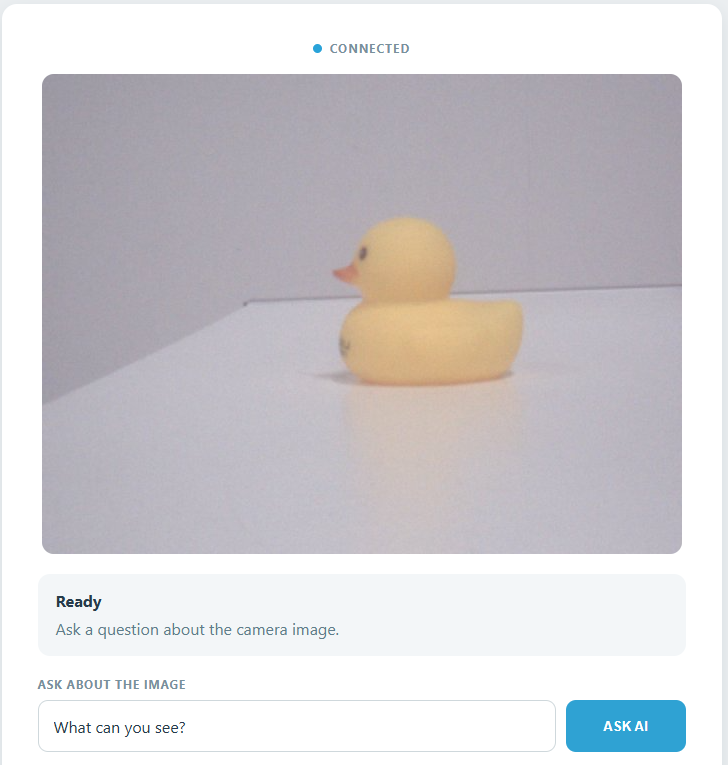

.. include:: /index.rst
   :start-after: start_hello_message
   :end-before: end_hello_message

05 AI Vision Assistant
======================

Every conversation in this module so far started with words you typed. This project hands the model something no amount of typing can describe: a picture. Point the camera at a mug, a toy, or your own hand, ask *"What is this?"* or *"How many are there?"*, and the answer comes back on the page — and out loud, from the board's speaker. Nothing in the app ever "sees" the picture; Python captures a frame, ships it to a vision-capable model, and reads back whatever sentence comes home.



In this lesson, you will learn to:

* Capture frames from the AVIO Carrier camera in Python, flip them upright, and stream them to the browser
* Send an actual image — not just words — to a vision-capable cloud model, and write a system prompt that keeps it honest about what it can see
* Keep the slow work off the main path: the cloud request and the spoken answer run on a worker thread while the live preview keeps moving
* Report each stage of the exchange — capturing, thinking, speaking, ready — to the one browser that asked
* Hear the answer instead of only reading it, using the ``sunfounder_tts`` brick

1. Setup
--------

**What You Need**

.. list-table::
   :widths: 25 25 25 25
   :header-rows: 0

   * - 1 * Pan Tilt Kit
     - 1 * USB-C Cable
     -
     -
   * - |list_pan_tilt|
     - |list_usb_cable|
     -
     -

**Software Requirements**

This project uses three App Lab **Bricks** — support packages that App Lab adds to your app for you:

* ``web_ui`` — serves the camera page and carries messages between the browser and Python
* ``cloud_llm`` — sends your question together with a camera frame to a cloud vision model and returns the answer
* ``sunfounder_tts`` — turns the finished answer into speech on the board's speaker

Because the model is reached over the internet, the project needs a key of your own. ``app.yaml`` declares the ``cloud_llm`` brick with an empty ``API_KEY``, so App Lab asks you for an **OpenAI API key** the first time you press **Run** and stores it for you. The ``cloud_llm`` brick also speaks to **Anthropic** and **Google** - see :ref:`llm_other_models` for the one line that changes.

There are no sketch libraries to install: this project has no ``sketch/`` folder at all, so nothing is compiled for the MCU and nothing crosses the Bridge.

No breadboard wiring is needed in this lesson: the camera, the speaker, and the whole "circuit" are already built into the AVIO Carrier.

.. note::

   Before using the camera, make sure external carriers are enabled on your UNO Q — this is a one-time setup: :ref:`enable_external_carriers`. A camera is never hot-swappable: disconnect the USB-C cable before you plug one in.

   The first time you run a TTS example on this UNO Q, App Lab needs to download and prepare the TTS runtime and audio dependencies. This may take half an hour or more, depending on your network connection.

   The first time you run this project, App Lab asks for your **OpenAI API key**, because the app uses the ``cloud_llm`` brick to reach the model. Paste a key from your OpenAI account and save it — App Lab keeps the key for your board, so you only do this once.

2. Run the App
--------------

#. Download :download:`05 AI Vision Assistant.zip <https://github.com/sunfounder/unoq-ai-kit/releases/latest/download/05.AI.Vision.Assistant.zip>`.
#. In App Lab, go to **Apps** → **Create new app** → **Import App** → **Import from Computer**, and open the package you downloaded.
#. Click the **Run** button (▶) in the top-right corner. Python opens the camera and starts capturing frames — there is no sketch in this project, so nothing is flashed to the board.

   .. image:: /img/app_run.png
      :width: 500
      :align: center

#. The Output window prints *"AI Vision Assistant ready."* and a **Web UI** tab opens by itself. The status row reads **Connecting** for a moment, then **Connected** with a blue dot, and the live camera view appears inside the frame.
#. Point the camera at something — a mug, a toy, your hand — and type a question in the box. The default text is *"What can you see?"*, and you can ask anything the picture could answer: *"What colour is it?"*, *"What is on the left?"*, *"How many fingers am I holding up?"*. Then click **ASK AI**.
#. The status panel walks through its stages while the answer is on its way: **Image Captured**, then **Thinking** with *"AI is looking at the image..."*, then **Speaking...** as the reply is read aloud. The button reads **PLEASE WAIT** and the box is locked for as long as this takes.
#. The answer lands in the **AI answer** card and the panel returns to **Ready**. The page looks like this — the live view at the top, the assistant's current state below it, and the question box underneath.

   .. image:: img/ai_vision_assistant.png
      :width: 600
      :align: center

**How it Works**

Here is the whole path a question travels — into the camera, up to the cloud, and back to you as a sentence you can hear.

An App Lab project is a folder of files. Here is what is inside this one:

* ``05 AI Vision Assistant/`` — the app folder

  * ``app.yaml`` — app metadata: name, icon, and the three Bricks the project declares
  * ``README.md`` — a short guide to the project

  * ``python/``

    * ``main.py`` — the camera loop, the MJPEG stream, the vision request, and the spoken answer

  * ``bricks/``

    * ``sunfounder_tts/`` — the text-to-speech brick the app ships with: the local voice server behind ``tts.say()``

  * ``assets/``

    * ``index.html`` — the assistant page: status row, camera frame, state panel, question box, and answer card
    * ``app.js`` — browser logic: the socket events, the state panel, and the stream retry
    * ``style.css`` — the visual styling of the page
    * ``libs/socket.io.min.js`` — the Socket.IO client that carries messages between the page and the board
    * ``img/sf_logo.png`` — the logo in the page header
    * ``docs_assets/`` — the result image used by this documentation

There is no ``sketch/`` folder here — nothing is flashed to the MCU, the Bridge is never used, and the entire app is Python running on the Linux MPU.

The data path, from a camera frame to a spoken answer:

.. mermaid::

   sequenceDiagram
       participant B as Browser (HTML/JS)
       participant P as Python (main.py)
       participant C as Camera (carrier CSI)
       participant L as Vision LLM (gpt-4o-mini)
       participant S as Speaker (sunfounder_tts)

       C->>P: camera.capture() - one frame, 20 per second
       P->>P: cv2.flip(frame, 0) - upright
       P->>P: cv2.imencode(".jpg", frame, 85) - JPEG bytes into current_frame
       B->>P: GET /stream - the MJPEG preview
       P-->>B: multipart/x-mixed-replace frames
       B->>P: socket.emit("ask_ai", {question})
       P->>P: copy the newest frame, start a worker thread
       P->>L: vlm.chat(message=question, images=[frame])
       L-->>P: a one- or two-sentence answer
       P-->>B: socket "vision_status" - the answer
       P->>S: tts.say(answer)
       P-->>B: socket "vision_status" - ready

Here is what each piece does:

**Python (main.py)** — runs on the Linux MPU
  * ``Camera(fps=20)`` is the whole camera setup — an App Lab peripheral, not a brick
  * ``loop()`` runs over and over: ``camera.capture()`` takes a frame, ``cv2.flip(frame, 0)`` turns it the right way up, and ``cv2.imencode(".jpg", frame, [cv2.IMWRITE_JPEG_QUALITY, 85])`` compresses it into JPEG bytes that are parked in a shared ``current_frame`` under ``frame_lock``

**Camera (App Lab peripheral)** — the AVIO Carrier's CSI camera
  * ``camera.capture()`` returns the newest frame, and the camera keeps producing them at 20 per second whether or not anybody is looking
  * The camera sits upside down in the carrier's bracket, so the vertical flip is what makes both the preview and the picture the model receives upright — the two always agree, because both come from that one ``current_frame``

**Vision LLM (behind the ``cloud_llm`` brick)** — runs on OpenAI's servers
  * The **system prompt** makes it a friendly visual assistant for students: answer only from what is visible in the supplied image, say so clearly when the picture cannot answer the question, keep it to one or two sentences, and reply in the language the question was asked in
  * ``temperature=0.3`` keeps the wording steady and ``max_tokens=160`` keeps the answer short — which also keeps the spoken version short

**Text-to-Speech (behind the ``sunfounder_tts`` brick)** — runs on the board
  * ``EdgeTTS()`` with ``set_voice("en-US-JennyNeural")`` and ``set_volume(50)`` prepares the voice
  * ``tts.say(answer)`` speaks the finished sentence while the page shows **Speaking...**

**Browser (HTML/JS)** — runs in your browser
  * ``socket.emit('ask_ai', {question})`` sends what you typed; the question form's submit handler is the only place that happens
  * ``cameraStream.src = http://<host>:7000/stream?r=<timestamp>`` loads the MJPEG stream into an ````, and the ``error`` listener retries it every 1.5 seconds if the picture drops

Notice that Python never understands the picture. It does not look for a mug or count fingers — it captures bytes, hands them to a model, and speaks the sentence that comes back.

3. Experiment
-------------

**Point It at the World and Ask**

The model answers only from the picture it was handed, so what you show it *is* the experiment. Try each of these and compare the card on screen with what you hear:

.. list-table::
   :header-rows: 1
   :widths: 45 55

   * - What you show the camera
     - What you ask — and what comes back
   * - A mug, a bottle, or a toy on the desk
     - *"What is this?"* — the model names the object and describes how it looks in a sentence or two
   * - Two or three objects side by side
     - *"Which object is on the left?"* — the answer depends on where things sit inside the frame, which is something only an image can tell it
   * - Your hand with some fingers raised
     - *"How many fingers am I holding up?"* — a counting question the picture answers at once
   * - An empty desk or a blank wall
     - *"What is on the desk?"* — the system prompt tells it to admit when the image cannot answer, so the reply should say that nothing is visible rather than invent an object
   * - Anything at all, asked in another language — *"¿Qué ves?"*
     - The system prompt asks for an answer in the language of the question, so the reply comes back in Spanish and the voice reads that same sentence aloud

4. Troubleshooting
------------------

**The camera frame stays dark and reads "Waiting for camera..."**

* **Cause:** No frames are arriving at all.
* **Solution:** Complete the one-time setup at :ref:`enable_external_carriers`, choosing the type that matches the connector your camera is plugged into, then let the board reboot.

**The status panel says "The camera image is not ready yet. Please try again."**

* **Cause:** You clicked **ASK AI** before the first frame had been captured, so the shared ``current_frame`` was still empty and there was nothing to send to the model.
* **Solution:** Wait until the live view is moving before you ask.

**The status panel turns red with "Vision assistant error: ..."**

* **Cause:** The request to the vision model failed.
* **Solution:** Check the board's internet connection first, since the model lives in the cloud.

5. Summary
----------

You just taught your UNO Q to look. The board takes a picture, sends it into the cloud with a question attached, gets a short answer back, and reads that answer to you out loud.

* A picture is just data: ``camera.capture()`` hands Python a frame, and ``cv2.imencode()`` shrinks it into JPEG bytes small enough to send
* The vision model is reached exactly like every other model in this module — one ``CloudLLM`` object, one ``chat()`` call — except that the message now travels with ``images=[frame]``
* The **system prompt** is what keeps a vision model honest: answer only from the image, admit when the picture cannot answer, stay brief, and reply in the reader's language
* The slow half of the work runs on a worker thread, so the live preview never freezes, and a ``busy`` flag keeps exactly one question in flight
* ``ui.send_message(..., room=sid)`` shows how a Web UI can answer one browser instead of all of them — every state change goes back only to the person who asked

This is the last project in this module, and it is worth looking back at how far one idea has travelled. First the model chose a colour from a list, then it held a conversation and picked a mood at the same time, and now it looks at the world and tells you what it sees. The board did not change — the camera, the speaker, and the Web UI were always there. What changed was the question you sent and the rules you wrapped around the answer. That is the whole skill this module has been building: the model supplies the understanding, and your code decides what is allowed to happen next. You have used it to light an LED, to pull a face, and now to see — and every project you build from here can reuse the same three pieces: an input on the board, a model for judgement, and a page that shows you what happened.
