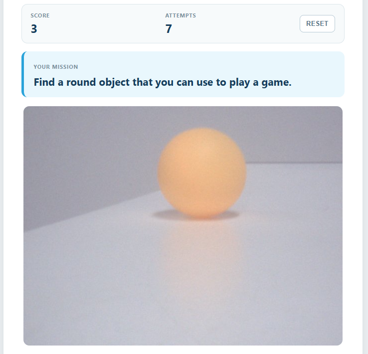

.. include:: /index.rst
   :start-after: start_hello_message
   :end-before: end_hello_message

06 AI Scavenger Hunt
====================

Every project in this module so far gave the model one job. Here it gets two, and they pull in opposite directions. First the model *invents* a challenge — *"Find something red"* — and then, when you hold an object up to the camera, the same model *judges* whether you found it. The mission is spoken aloud, the verdict comes back as a strict piece of JSON, and the board answers with colour and sound: yellow while a mission is live, green with two rising tones when you get it right, red with one low note when you do not.

In this lesson, you will learn to:

* Call a cloud model twice for two very different jobs — one prompt that writes the game, another that referees it
* Ask a vision model for **structured output** and parse it as JSON, so the verdict is a value your code can trust instead of a sentence it has to interpret
* Turn a game event into hardware feedback through one small integer, a ``switch``, an ``analogWrite()``, and a ``tone()``
* Keep the mission, the score, and the attempts in one shared state object, so every screen update is built from the same truth
* Read the difference between a model that is *creative* (``temperature=0.9``) and one that is *careful* (``temperature=0.1``)

1. Setup
--------

**What You Need**

.. list-table::
   :widths: 25 25 25 25
   :header-rows: 0

   * - 1 * Pan Tilt Kit
     - 1 * :ref:`cpn_rgb_led` (common cathode)
     - 3 * :ref:`cpn_resistor` (220Ω)
     - 1 * :ref:`cpn_buzzer`
   * - |list_pan_tilt|
     - |list_rgb_led|
     - |list_220ohm|
     - |list_active_buzzer|
   * - 1 * :ref:`cpn_breadboard`
     - Several :ref:`cpn_wires`
     - 1 * USB-C Cable
     -
   * - |list_breadboard|
     - |list_wire|
     - |list_usb_cable|
     -

**Software Requirements**

This project uses three App Lab **Bricks** — support packages that App Lab adds to your app for you:

* ``web_ui`` — serves the game page and carries the game state between the browser and Python
* ``cloud_llm`` — writes each mission and referees the camera image with a cloud vision model
* ``sunfounder_tts`` — reads the mission and the referee's verdict aloud on the board's speaker

Because the model is reached over the internet, the project needs a key of your own. ``app.yaml`` declares the ``cloud_llm`` brick with an empty ``API_KEY``, so App Lab asks you for an **OpenAI API key** the first time you press **Run** and stores it for you. The ``cloud_llm`` brick also speaks to **Anthropic** and **Google** - see :ref:`llm_other_models` for the one line that changes.

There are no libraries to install on the sketch side either: ``sketch.yaml`` declares no ``libraries:`` section at all, so the only code the MCU runs is the sketch itself.

.. note::

   The first time you run a TTS example on this UNO Q, App Lab needs to download and prepare the TTS runtime and audio dependencies. This may take half an hour or more, depending on your network connection.
   The first time you run this project, App Lab asks for your **OpenAI API key**, because the app uses the ``cloud_llm`` brick to reach the model. Paste a key from your OpenAI account and save it — App Lab keeps the key for your board, so you only do this once.

**Wiring Diagram**

The RGB LED has four legs: the longest one is the **common cathode** and goes to **GND**, while the red, green, and blue anodes go to **D8**, **D7**, and **D6**, each through its own **220Ω** resistor. The buzzer sits beside it, with its **+** leg on **D5** and its **−** leg on **GND**. Never connect an LED channel straight to a pin without its resistor — the LED can burn out.

.. image:: /img/wiring/wiring_pc_buzzer_rgb.png
   :width: 600
   :align: center

2. Run the App
--------------

#. Download :download:`06 AI Scavenger Hunt.zip <https://github.com/sunfounder/unoq-ai-kit/releases/latest/download/06.AI.Scavenger.Hunt.zip>`.
#. In App Lab, go to **Apps** → **Create new app** → **Import App** → **Import from Computer**, and open the package you downloaded.
#. Click the **Run** button (▶) in the top-right corner. The sketch takes control of the RGB LED and the buzzer, and the Python side opens the camera and starts the Web UI.

   .. image:: /img/app_run.png
      :width: 500
      :align: center

#. The Output window prints *"AI Scavenger Hunt ready."* and a **Web UI** tab opens by itself. The status row reads **Connecting** for a moment, then **Connected** with a blue dot, and the live camera view appears inside the frame. Every button stays greyed out until that dot turns blue.
#. Click **NEW MISSION**. The status panel reads **Creating Mission**, the mission card fills with a sentence the model has just invented — something like *"Find something used for writing"* — and the RGB LED turns **yellow**. Once the mission has been spoken, the panel returns to **Ready** and **CHECK OBJECT** becomes available.
#. Show a matching object to the camera and click **CHECK OBJECT**. The panel walks through its stages — **Image Captured**, then **AI Referee Is Thinking**, then **Speaking** — while the referee's one-sentence explanation appears in the **AI Referee** card at the bottom.
#. A match turns the LED **green**, plays two rising tones, adds one point to **Score**, and the status reads **Mission Complete**. A mismatch turns the LED **red**, plays one low note, adds one to **Attempts**, and lets you try the same mission again with another object.
#. Click **RESET** whenever you want a fresh start: the score and attempts go back to zero, the mission is cleared, and the LED goes out.
#. The page looks like this — the score board at the top, the mission below it, the live view in the middle, and the referee's verdict at the bottom.

   .. image:: img/ai_scavenger_hunt.png
      :width: 600
      :align: center

**How it Works**

Here is the whole path a mission travels — written in the cloud, shown to the camera, and answered with light and sound.

An App Lab project is a folder of files. Here is what is inside this one:

* ``06 AI Scavenger Hunt/`` — the app folder

  * ``app.yaml`` — app metadata: name, icon, and the three Bricks the project declares
  * ``README.md`` — a short guide to the project

  * ``python/``

    * ``main.py`` — the mission writer, the camera loop, the referee call, and the Bridge feedback

  * ``sketch/``

    * ``sketch.ino`` — the RGB LED pins, the buzzer notes, and the Bridge function
    * ``sketch.yaml`` — sketch configuration for the UNO Q board

  * ``bricks/``

    * ``sunfounder_tts/`` — the text-to-speech brick the app ships with: the local voice server behind ``tts.say()``

  * ``assets/``

    * ``index.html`` — the game page: score board, mission card, camera frame, status panel, and referee card
    * ``app.js`` — browser logic: the three buttons, the game state, and the stream retry
    * ``style.css`` — the visual styling of the page
    * ``libs/socket.io.min.js`` — the Socket.IO client that carries messages between the page and the board
    * ``img/sf_logo.png`` — the logo in the page header
    * ``docs_assets/`` — the result and wiring images used by this documentation

The data path, from a written mission to a judged object:

.. mermaid::

   sequenceDiagram
       participant B as Browser (HTML/JS)
       participant P as Python (main.py)
       participant C as Camera (App Lab)
       participant L as Cloud LLM (gpt-4o-mini)
       participant S as Sketch (sketch.ino)
       participant T as TTS (sunfounder_tts)

       B->>P: socket.emit("new_mission")
       P->>L: task_llm.chat(message) - write one mission
       L-->>P: "Find something used for writing"
       P->>S: Bridge.call("game_feedback", 1)
       S->>S: setRgb(255, 160, 0) - yellow
       P->>T: tts.say("Your mission is: ...")
       P-->>B: game_state - speaking, then ready
       C->>P: camera.capture() - a frame, 20 per second
       P->>P: cv2.flip(frame, 0), then JPEG bytes
       B->>P: GET /stream - the live preview
       P-->>B: multipart/x-mixed-replace frames
       B->>P: socket.emit("check_object")
       P->>L: judge_llm.chat(message, images=[frame])
       L-->>P: JSON with success true or false
       P->>S: Bridge.call("game_feedback", 2 or 3)
       S->>S: setRgb(0, 255, 0), then two rising tones
       P->>T: tts.say("Mission complete! ...")
       P-->>B: game_state - complete, score plus one

Here is what each piece does:

**Sketch (sketch.ino)** — runs on the STM32 MCU
  * ``setup()`` sets **D8**, **D7**, **D6**, and **D5** to outputs, clears the LED, then calls ``Bridge.begin()``
  * ``setRgb(r, g, b)`` writes the three brightness values with ``analogWrite()`` on **D8** (red), **D7** (green), and **D6** (blue)

**Python (main.py)** — runs on the Linux MPU
  * ``WebUI()`` serves the game page from ``assets/`` and hosts one extra route
  * ``ui.expose_api("GET", "/stream", video_stream)`` answers that route with a ``StreamingResponse`` of ``multipart/x-mixed-replace`` frames, which is what makes the picture move in the browser

**Cloud LLM (behind the ``cloud_llm`` brick)** — runs on OpenAI's servers
  * One system prompt makes the model a **mission writer**: one short English mission beginning with *"Find"*, built from a visible property or an everyday purpose such as colour, shape, material, or use — and never about anything sharp, hot, heavy, breakable, dangerous, expensive, private, or alive
  * The other makes it a **fair referee**: judge only what is clearly visible in the supplied image, mark anything that cannot be verified visually as unsuccessful, and answer with one JSON object of the form ``{"success": true, "message": "One short sentence"}``

**Bridge** — the channel between the MPU and the MCU
  * Sketch side: ``Bridge.provide("game_feedback", game_feedback)`` exposes the feedback function
  * Python side: ``Bridge.call("game_feedback", code)`` invokes it with one integer

**Browser (HTML/JS)** — runs in your browser
  * ``socket.emit('new_mission', {})``, ``socket.emit('check_object', {})``, and ``socket.emit('reset_game', {})`` are the three buttons; ``socket.on('connect')`` also sends ``get_state``, so the page opens on the real score instead of a guess
  * ``loadCameraStream()`` sets ``cameraStream.src`` to ``http://<host>:7000/stream?r=<timestamp>``, and the ``error`` listener retries it every 1.5 seconds if the picture drops

Notice that the two model calls never see each other. The writer produces a sentence that ``clean_task()`` has to tame, because a chatty model will happily add quotes, numbering, and hints; the referee produces JSON that ``parse_judgement()`` accepts only on its own strict terms.

3. Experiment
-------------

**Play Against the Referee**

The referee only knows what is in the frame at the instant you click, so what you show it *is* the experiment. Try each of these and watch the LED, the buzzer, the score, and the referee card at the same time:

.. list-table::
   :header-rows: 1
   :widths: 40 60

   * - What you do
     - What happens
   * - Click **NEW MISSION** two or three times
     - Each mission is a different sentence, because the prompt carries the last five missions and asks for something new
   * - Show an object that plainly matches
     - The LED turns green, the buzzer plays two rising tones, the score goes up by one, and the referee explains the match
   * - Show an object that clearly does not match
     - The LED turns red, the buzzer plays one low note, the attempts go up by one, and the same mission stays on screen
   * - Show a matching object in dim light, or small in a large frame
     - The verdict can go against you even though the object is right — the prompt tells the referee to mark anything it cannot verify as unsuccessful
   * - Hold up two objects at once, one matching and one not
     - The referee judges only the *main* visible object, so whatever fills the frame decides the outcome
   * - Click **RESET**
     - The score and attempts return to zero, the mission is cleared, and the LED goes out

4. Troubleshooting
------------------

**The status panel says "Choose NEW MISSION first."**

* **Cause:** You clicked **CHECK OBJECT** before a mission existed.
* **Solution:** Click **NEW MISSION** and wait for the mission to appear on the card and be spoken.

**The status panel says "The camera image is not ready yet."**

* **Cause:** You clicked **CHECK OBJECT** before the first frame had been captured, so the shared ``current_frame`` was still empty and there was nothing to send to the model.
* **Solution:** Wait until the live view is moving before you check an object.

**The status panel turns red with "Unable to create a mission..." or "Unable to check the object..."**

* **Cause:** The request to the cloud model failed.
* **Solution:** Check the board's internet connection first, since both models live in the cloud.

5. Summary
----------

You just built a game that writes its own rules and then judges you by them. The board invents a mission, speaks it aloud, watches you through the camera, and answers with colour, sound, and a score — and the only thing that changed between the two model calls was the sentence of instruction wrapped around each one.

* A single model can play two roles at once: ``task_llm`` writes the mission at ``temperature=0.9``, while ``judge_llm`` referees it at ``temperature=0.1``
* **Structured output** turns an opinion into data — the referee is told to answer with ``{"success": true, "message": "..."}``, and ``parse_judgement()`` accepts the verdict only when that JSON parses and ``success`` is exactly ``True``
* The same one-integer Bridge protocol as the earlier projects is enough for a whole game: 1 yellow, 2 green with two rising tones, 3 red with one low note, 0 off
* One shared state object — mission, score, attempts, result — means the page, the referee card, and the status panel can never disagree
* Both halves of the exchange run on worker threads, so the live preview keeps moving while the model thinks, and the ``busy`` flag keeps exactly one request in flight

The next project puts the model on the other side of the desk. Instead of writing a mission and judging an object, it will write the quiz questions *and* decide whether your answers are correct — so the intelligence that checks you is the same intelligence that set the test. Everything you built here is the groundwork: two prompts with two jobs, a shared game state, and a board that reacts the moment the verdict arrives.
