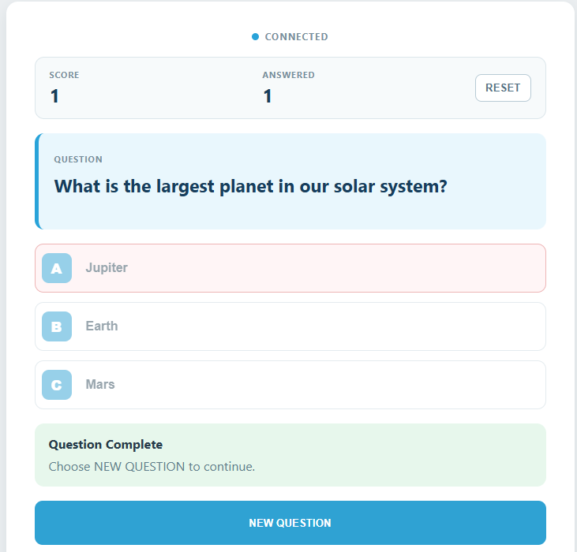

.. include:: /index.rst
   :start-after: start_hello_message
   :end-before: end_hello_message

07 AI Quiz Show
===============

The board has listened to you, argued with you, pulled a face, and looked at the world. Now it takes the teacher's chair. Ask it for a question and it writes one on the spot — three choices, one correct answer, and a short explanation — then reads the whole thing aloud. You answer with a button on the page, and the verdict arrives all at once: a coloured light, a buzzer tone, a spoken sentence, and a point on the scoreboard. The clever part is not that the model writes the question; it is that the model is asked for *data* rather than a paragraph, so every field the page needs already has a name before a single word reaches the browser.

In this lesson, you will learn to:

* Ask a cloud model for **structured data** — a question, three choices, the correct letter, and an explanation — instead of a sentence your code cannot use
* Pull JSON out of a model's reply and validate every field before it is allowed on screen
* Turn one small integer into feedback on three different outputs at once: an RGB colour, a buzzer tone, and a spoken sentence
* Keep the score and the number of answered questions on the board, and restore them when a browser reloads
* Keep a whole round down to a single cloud request by comparing the answer locally

1. Setup
--------

**What You Need**

.. list-table::
   :widths: 25 25 25 25
   :header-rows: 0

   * - 1 * Pan Tilt Kit
     - 1 * :ref:`cpn_rgb_led` (common cathode)
     - 3 * :ref:`cpn_resistor` (220Ω)
     - 1 * :ref:`cpn_buzzer` (passive)
   * - |list_pan_tilt|
     - |list_rgb_led|
     - |list_220ohm|
     - |list_passive_buzzer|
   * - 1 * :ref:`cpn_breadboard`
     - Several :ref:`cpn_wires`
     - 1 * USB-C Cable
     -
   * - |list_breadboard|
     - |list_wire|
     - |list_usb_cable|
     -

**Software Requirements**

This project uses three App Lab **Bricks** — support packages that App Lab adds to your app for you:

* ``web_ui`` — serves the quiz page and carries every message between the browser and Python
* ``cloud_llm`` — asks a cloud language model for a new question and returns the JSON behind it
* ``sunfounder_tts`` — reads the question, the three choices, and the explanation aloud on the board's speaker

Because the model is reached over the internet, the project needs a key of your own. ``app.yaml`` declares the ``cloud_llm`` brick with an empty ``API_KEY``, so App Lab asks you for an **OpenAI API key** the first time you press **Run** and stores it for you. The ``cloud_llm`` brick also speaks to **Anthropic** and **Google** - see :ref:`llm_other_models` for the one line that changes.

The sketch declares no external libraries: ``sketch.yaml`` has no ``libraries:`` section at all, because the Bridge library that lets Python call the sketch is part of the UNO Q core and needs no installation.

.. note::

   The first time you run a TTS example on this UNO Q, App Lab needs to download and prepare the TTS runtime and audio dependencies. This may take half an hour or more, depending on your network connection.
   The first time you run this project, App Lab asks for your **OpenAI API key**, because the app uses the ``cloud_llm`` brick to reach the model. Paste a key from your OpenAI account and save it — App Lab keeps the key for your board, so you only do this once.

**Wiring Diagram**

The RGB LED's red, green, and blue anodes go to **D8**, **D7**, and **D6**, each through its own **220Ω** resistor, and the longest leg — the **common cathode** — goes to **GND**; the passive buzzer's **+** leg goes to **D5** and its **−** leg to **GND**.

.. image:: /img/wiring/wiring_pc_buzzer_rgb.png
   :width: 600
   :align: center

2. Run the App
--------------

#. Download :download:`07 AI Quiz Show.zip <https://github.com/sunfounder/unoq-ai-kit/releases/latest/download/07.AI.Quiz.Show.zip>`.
#. In App Lab, go to **Apps** → **Create new app** → **Import App** → **Import from Computer**, and open the package you downloaded.
#. Wire the RGB LED and the passive buzzer as the diagram shows, then connect the board and click the **Run** button (▶) in the top-right corner. The sketch is flashed to the board and Python starts the Web UI; the RGB LED stays dark until the first question is created, because this sketch has no colour self-test.

   .. image:: /img/app_run.png
      :width: 500
      :align: center

The **Web UI** tab opens by itself — the next section walks through what to do with it.

**How it Works**

Here is the whole path a round travels — a request out to the model, a question onto the page, and one click that comes back as light, sound, and speech.

An App Lab project is a folder of files. Here is what is inside this one:

* ``07 AI Quiz Show/`` — the app folder

  * ``app.yaml`` — app metadata: name, icon, and the three Bricks the project declares
  * ``README.md`` — a short guide to the project

  * ``python/``

    * ``main.py`` — the question request, the JSON parsing, the scoring, and the Bridge calls

  * ``sketch/``

    * ``sketch.ino`` — the RGB and buzzer pins, the two tone patterns, and the ``quiz_feedback()`` function
    * ``sketch.yaml`` — sketch configuration for the UNO Q board

  * ``bricks/``

    * ``sunfounder_tts/`` — the text-to-speech brick the app ships with: the local voice server behind ``tts.say()``

  * ``assets/``

    * ``index.html`` — the quiz page: score board, question card, three choice buttons, status panel, and explanation card
    * ``app.js`` — browser logic: the socket events, the button locking, and the panel repainting
    * ``style.css`` — the visual styling of the page
    * ``libs/socket.io.min.js`` — the Socket.IO client that carries messages between the page and the board
    * ``img/sf_logo.png`` — the logo in the page header
    * ``docs_assets/`` — the wiring and result images used by this documentation

The data path, from a click on **NEW QUESTION** to a verdict you can hear:

.. mermaid::

   sequenceDiagram
       participant B as Browser (HTML/JS)
       participant P as Python (main.py)
       participant L as Cloud LLM (gpt-4o-mini)
       participant S as Sketch (sketch.ino)
       participant T as Speaker (sunfounder_tts)

       B->>P: socket.emit("new_question")
       P->>L: llm.chat(prompt) - ask for one quiz JSON
       L-->>P: question, choices A B C, answer, explanation
       P->>P: parse_quiz() - validate every field
       P->>S: Bridge.call("quiz_feedback", 1)
       S->>S: setRgb(255, 160, 0) - yellow, waiting
       P->>T: tts.say(question and the three choices)
       P-->>B: socket "quiz_state" - ready
       B->>P: socket.emit("submit_answer", answer)
       P->>P: selected == quiz["answer"]
       P->>S: Bridge.call("quiz_feedback", 2 or 3)
       S->>S: green and two tones, or red and one low tone
       P-->>B: socket "quiz_state" - correct or wrong
       P->>T: tts.say(the explanation)

Here is what each piece does:

**Sketch (sketch.ino)** — runs on the STM32 MCU
  * ``setup()`` sets **D5**, **D6**, **D7**, and **D8** to outputs, blanks the LED with ``setRgb(0, 0, 0)``, then calls ``Bridge.begin()``
  * ``setRgb(r, g, b)`` writes the three channels with ``analogWrite()`` on **D8** (red), **D7** (green), and **D6** (blue)

**Python (main.py)** — runs on the Linux MPU
  * ``WebUI()`` serves the quiz page from ``assets/``, and ``ui.on_message("new_question", request_question)`` together with ``submit_answer`` and ``reset_quiz`` listens for the three things the page can send
  * ``CloudLLM(model="openai:gpt-4o-mini", system_prompt=QUIZ_SYSTEM_PROMPT, temperature=0.8, max_tokens=180)`` creates the link to the model and fixes its behaviour up front

**Cloud LLM (behind the ``cloud_llm`` brick)** — runs on OpenAI's servers
  * The **system prompt** makes it a quiz writer for students: varied general-knowledge topics, exactly three choices with exactly one correct answer, and no trick questions, politics, violence, adult topics, or time-sensitive facts
  * It insists on one JSON object with a fixed shape — ``question``, ``choices``, ``answer``, and ``explanation`` — so the code always knows which fields to expect

**Bridge** — the channel between the MPU and the MCU
  * Sketch side: ``Bridge.provide("quiz_feedback", quiz_feedback)`` exposes the feedback function
  * Python side: ``Bridge.call("quiz_feedback", code)`` invokes it with one integer

**Speaker (sunfounder_tts)** — runs on the board
  * ``EdgeTTS()`` with ``set_voice("en-US-JennyNeural")`` and ``set_volume(50)`` prepares the voice, and ``tts.say(...)`` speaks a finished sentence
  * The question is read with its three choices in order, so a player watching the LED still hears the whole round; the explanation is spoken after the verdict

**Browser (HTML/JS)** — runs in your browser
  * ``socket.emit('new_question', {})``, ``socket.emit('submit_answer', {answer})``, ``reset_quiz``, and ``get_state`` are the only messages the page sends
  * ``socket.on('quiz_state', updateState)`` repaints everything from one payload: the question card, the three choice labels, the score, the answered count, and the status panel

Notice how much of this quiz is ordinary bookkeeping. The model supplies the words, but Python supplies the shape: a fixed set of fields, three choices that must all be present, an answer letter that must be one of them, one question at a time, and a score that only ever moves inside ``state_lock``.

3. Experiment
-------------

**Play Faster Than the Voice**

Every round is the same three stages — asking, reading, answering — so the fun is in the timing. Try each of these and watch the panel, the LED, and the buzzer at the same time:

.. list-table::
   :header-rows: 1
   :widths: 40 60

   * - What you do
     - What happens
   * - Click **NEW QUESTION** and wait
     - The panel walks **Creating Question** → **Reading Question** → **Ready**, and the RGB LED turns yellow as soon as the question has arrived
   * - Click **A**, **B**, or **C** while the question is still being read
     - Nothing moves — the buttons stay disabled on purpose, because a round you could answer before hearing it would not be much of a quiz
   * - Click the correct choice
     - The LED turns green, the buzzer plays two rising tones, the panel reads **Correct!**, the score goes up by one, and the explanation appears and is read aloud
   * - Click a wrong choice
     - The LED turns red, the buzzer plays one low tone, the panel tells you which letter was right, and the explanation still arrives
   * - Answer one question twice
     - Impossible — Python sets ``answered`` the instant you click, so a second ``submit_answer`` for the same question is ignored
   * - Click **RESET** between rounds
     - The score and the answered count return to 0, the LED goes dark, and the panel reads *"Score reset. Choose NEW QUESTION to begin."*
   * - Reload the page in the middle of a round
     - The dot returns to **Connected** and ``get_state`` restores the current question and score straight from Python

4. Troubleshooting
------------------

**The status panel turns red with "Unable to create a question: ..."**

* **Cause:** The cloud request failed, or the reply could not be turned into a question.
* **Solution:** Check the board's internet connection first, since the model lives in the cloud, then confirm your key is still valid and funded in your OpenAI account, stop the app, and press **Run** again to enter a fresh key.

**The A/B/C buttons stay greyed out**

* **Cause:** The buttons are locked until the app has a question *and* is no longer busy.
* **Solution:** Watch the status panel rather than the buttons.

**The LED shows yellow but never turns green or red**

* **Cause:** The Bridge call is not reaching the sketch.
* **Solution:** Make sure ``Bridge.provide("quiz_feedback", quiz_feedback)`` in the sketch matches ``Bridge.call("quiz_feedback", code)`` in Python exactly — the names are case-sensitive.

5. Summary
----------

You just built a quiz show that writes its own questions. The board asks a cloud model for structured data, checks that the data makes sense, reads it out loud, judges your answer, and reports the verdict through an LED, a buzzer, a voice, and a scoreboard — all from a single click on the page.

* Asking for **JSON** instead of prose is what turns a chat reply into data — one ``json.loads()`` and the question, the choices, the answer, and the explanation become fields your program can use
* ``parse_quiz()`` is the gate: a missing choice or an answer letter that is not one of the choices is refused outright, so a malformed reply becomes a message on screen instead of a broken round
* The answer is checked locally with ``selected == quiz["answer"]``, so a round costs exactly one cloud request and the score never depends on the network
* One tiny integer carries the whole verdict to the hardware — ``Bridge.call("quiz_feedback", code)`` drives the RGB colour and the buzzer pattern from a single ``switch``
* Score, answered count, and the current question all live in Python behind ``state_lock``, so a browser that reloads asks for ``get_state`` and picks the round up where it left off

The next project hands the model something far less tidy than a scoreboard: the camera. You will roll a set of story dice, photograph what they show, and listen while the model turns that picture into a narrated story — the same three pieces you have used all along, an input on the board, a model for judgement, and a page that shows you what happened.

