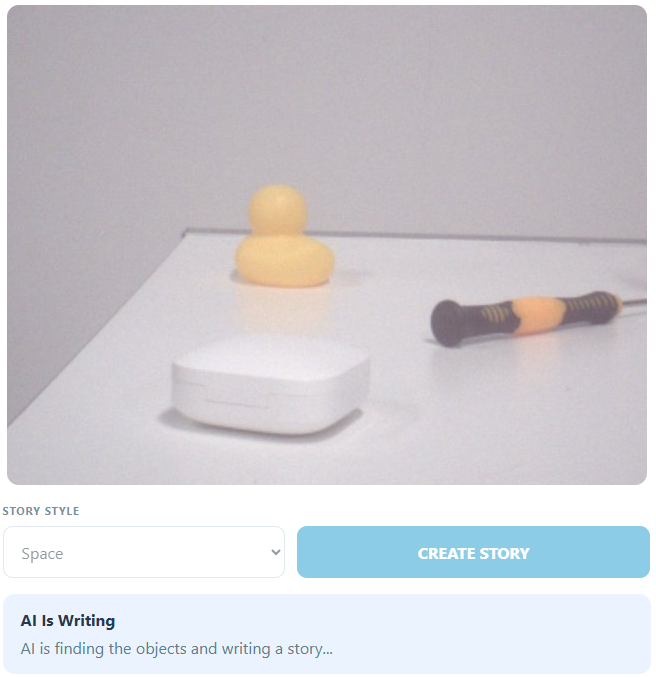

.. include:: /index.rst
   :start-after: start_hello_message
   :end-before: end_hello_message

08 AI Story Dice
================

Every project in this module so far has asked the model a question and handed it words to answer. This one hands it a picture and asks for a story. Put two or three everyday objects in front of the camera, pick a style — adventure, funny, mystery, magical, or space — and the model decides what the objects are, weaves them into three short sentences, gives the story a title, and names its mood. The page shows the objects and the story, the speaker reads it aloud, and the UNO Q's built-in LED matrix pulls the face that matches the mood.

In this lesson, you will learn to:

* Ask a vision-capable model for **structured JSON** instead of free prose, and then parse that answer without trusting a single character of it
* Give one model request four jobs at once — find the objects, write the title, write the story, and choose the mood
* Keep the slow work off the main path, so the live preview keeps moving while the story is being written
* Drive two different outputs from one answer: words and a voice on the board, and a face on the built-in LED matrix
* See the pattern *the model decides, the code enforces* at full stretch, where everything the model says is checked before it reaches the speaker, the screen, or the matrix

1. Setup
--------

**What You Need**

.. list-table::
   :widths: 25 25 25 25
   :header-rows: 0

   * - 1 * Pan Tilt Kit
     - 1 * USB-C Cable
     -
     -
   * - |list_pan_tilt|
     - |list_usb_cable|
     -
     -

**Software Requirements**

This project uses three App Lab **Bricks** — support packages that App Lab adds to your app for you:

* `web_ui` — serves the story page and carries messages between the browser and Python
* `cloud_llm` — sends the camera frame and your chosen style to a cloud vision model, and returns the story as JSON
* `sunfounder_tts` — narrates the finished story on the board's speaker

Because the model is reached over the internet, the project needs a key of your own. `app.yaml` declares the `cloud_llm` brick with an empty `API_KEY`, so App Lab asks you for an **OpenAI API key** the first time you press **Run** and stores it for you. The ``cloud_llm`` brick also speaks to **Anthropic** and **Google** - see :ref:`llm_other_models` for the one line that changes.

The sketch declares no libraries of its own in `sketch.yaml`. The two headers it includes — the Bridge library and the LED matrix library — ship with the UNO Q core, so there is nothing to install.

No breadboard wiring is needed in this lesson: the camera sits on the AVIO Carrier, and the mood display is the LED matrix that is already built into the UNO Q. There is nothing to connect before you press **Run**.

.. note::

   The first time you run a TTS example on this UNO Q, App Lab needs to download and prepare the TTS runtime and audio dependencies. This may take half an hour or more, depending on your network connection.

   The first time you run this project, App Lab asks for your **OpenAI API key**, because the app uses the `cloud_llm` brick to reach the model. Paste a key from your OpenAI account and save it — App Lab keeps the key for your board, so you only do this once.

2. Run the App
--------------

#. Download :download:`08 AI Story Dice.zip <https://github.com/sunfounder/unoq-ai-kit/releases/latest/download/08.AI.Story.Dice.zip>`.
#. In App Lab, go to **Apps** → **Create new app** → **Import App** → **Import from Computer**, and open the package you downloaded.
#. Click the **Run** button (▶) in the top-right corner. The sketch draws the calm face on the LED matrix, then the Python side opens the camera and starts the Web UI.

   .. image:: /img/app_run.png
      :width: 500
      :align: center

The **Web UI** tab opens by itself — the next section walks through what to do with it.

**How it Works**

Here is the whole path a story travels — in through the camera, up to the cloud, and back out as words, a voice, and a face.

An App Lab project is a folder of files. Here is what is inside this one:

* `08 AI Story Dice/` — the app folder

  * `app.yaml` — app metadata: name, icon, and the three Bricks the project declares
  * `README.md` — a short guide to the project

  * `python/`

    * `main.py` — the camera loop, the MJPEG stream, the story request, the JSON parser, and the Bridge call

  * `sketch/`

    * `sketch.ino` — the four mood faces, the mood switch, and the Bridge function
    * `sketch.yaml` — sketch configuration for the UNO Q board

  * `bricks/`

    * `sunfounder_tts/` — the text-to-speech brick the app ships with: the local voice server behind `tts.say()`

  * `assets/`

    * `index.html` — the story page: status row, camera frame, style picker, object chips, and story card
    * `app.js` — browser logic: the socket events, the state panel, the object chips, and the stream retry
    * `style.css` — the visual styling of the page, including one colour for each mood
    * `libs/socket.io.min.js` — the Socket.IO client that carries messages between the page and the board
    * `img/sf_logo.png` — the logo in the page header
    * `docs_assets/` — the result image used by this documentation

The data path, from three objects on the desk to a story you can hear and see:

.. mermaid::

   sequenceDiagram
       participant B as Browser (HTML/JS)
       participant P as Python (main.py)
       participant C as Camera (AVIO Carrier)
       participant L as Vision LLM (gpt-4o-mini)
       participant S as Sketch (sketch.ino)

       C->>P: camera.capture() - one frame, 20 per second
       P->>P: cv2.flip(frame, 0) - upright, then JPEG at quality 85
       B->>P: GET /stream - the MJPEG preview
       P-->>B: multipart frames of the newest image
       B->>P: socket.emit("create_story", {genre})
       P->>P: copy the newest frame, start a worker thread
       P->>S: Bridge.call("show_story_mood", 2)
       P->>L: llm.chat(message, images=[frame])
       L-->>P: one JSON object with objects, title, story, mood
       P->>P: parse_story() - three objects and a known mood
       P->>S: Bridge.call("show_story_mood", 1)
       P-->>B: socket "story_state" - objects, title, story
       P->>P: tts.say(title and story)
       P-->>B: socket "story_state" - ready

Here is what each piece does:

**Sketch (sketch.ino)** — runs on the STM32 MCU
  * `setup()` starts the display with `matrix.begin()`, sets `matrix.setGrayscaleBits(3)`, clears the grid, and draws the calm face
  * Each mood is a 104-value brightness array — 8 rows of 13 columns — painted with `matrix.draw()`

**Python (main.py)** — runs on the Linux MPU
  * `Camera(fps=20)` is the whole camera setup — an App Lab peripheral, not a brick — and `with camera: App.run(user_loop=loop)` opens it before the first frame
  * `loop()` runs over and over: `camera.capture()` takes a frame, `cv2.flip(frame, 0)` turns it the right way up, and `cv2.imencode(".jpg", frame, [cv2.IMWRITE_JPEG_QUALITY, 85])` compresses it into JPEG bytes that are parked in a shared `current_frame` under `frame_lock`

**Cloud LLM (behind the `cloud_llm` brick)** — runs on OpenAI's servers
  * The **system prompt** makes the model a creative storyteller for students: examine only the supplied camera image, identify up to three clear ordinary objects, never claim to see an object that is not visible, and avoid violence, fear, adult content, brands, and personal identification
  * It also demands the answer as valid JSON with the exact keys `objects`, `title`, `story`, and `mood`, where the story is exactly three short sentences under 70 words and the mood is one of happy, mysterious, exciting, or calm

**Bridge** — the channel between the MPU and the MCU
  * Sketch side: `Bridge.provide("show_story_mood", show_story_mood)` exposes the face function
  * Python side: `Bridge.call("show_story_mood", code)` invokes it with one integer

**Browser (HTML/JS)** — runs in your browser
  * `socket.emit('create_story', {genre: genreSelect.value})` sends the chosen style; the **CREATE STORY** button is the only place that happens
  * `socket.emit('get_state', {})` runs on `connect`, so a freshly opened page asks for the current story right away instead of showing an empty card

Notice how much of this project is validation rather than generation. The model is free to invent a story, but it is not free to invent the *shape* of its answer: the code looks for braces, parses JSON, keeps three objects, trims the title and the story, and quietly turns a mood it does not recognise into calm.

3. Experiment
-------------

**Roll the Story Dice**

The objects are the dice and the style is the roll. Keep the same two or three objects on the desk and work down the list, comparing the object chips, the story card, and the face on the matrix each time:

.. list-table::
   :header-rows: 1
   :widths: 30 70

   * - What you change
     - What happens
   * - **Adventure**
     - The objects become travellers or tools on a journey, and the mood often lands on **exciting**
   * - **Funny**
     - The objects are given silly voices and a punchline, and the mood usually lands on **happy**
   * - **Mystery**
     - One object turns into a clue and the story ends on a question, which is where the mysterious face fits best
   * - **Magical**
     - The objects are handed impossible powers — a key that opens any door, a cup that never empties
   * - **Space**
     - The same objects become equipment on a distant planet, and the story borrows words like orbit and signal
   * - Swap one object, keep the style
     - The title, the object chips, and usually the mood all change — proof that the picture, not the words, is what the model is working from
   * - Add a fourth object
     - Only three of them are used, because the prompt asks for up to three clear objects and the parser keeps three names at most

4. Troubleshooting
------------------

**The camera frame stays dark and reads "Waiting for camera..."**

* **Cause:** No frames are arriving at all.
* **Solution:** Check the camera connection first, then stop the app and press **Run** again, watching the Output window for errors as it starts.

**The panel turns red with "Unable to create a story: ..."**

* **Cause:** The request to the vision model failed, or its answer could not be parsed.
* **Solution:** Read the exception first.

**The panel says "The camera image is not ready yet."**

* **Cause:** You clicked **CREATE STORY** before the first frame had been captured, so the shared `current_frame` was still empty and there was nothing to send to the model.
* **Solution:** Wait until the live view is moving before you click.

5. Summary
----------

You just turned a handful of objects into a story. The board took a picture, sent it into the cloud with a style attached, and got back a title, three sentences, and a mood — then spoke them, showed them, and pulled a face to match.

* Asking for **JSON** in the system prompt is what turns a creative model into a part your code can use: named keys, a fixed length, and a mood chosen from a list
* `parse_story()` treats the answer as untrusted input — it finds the braces, parses them, trims every field, and replaces an unknown mood with `calm`
* One answer drives three outputs at once: text and chips on the page, a voice on the speaker, and one integer across the Bridge to the LED matrix
* The cloud request and the spoken narration run on a worker thread, so the live preview keeps moving while the story is written
* `ui.send_message(..., room=sid)` keeps the exchange private: every stage goes back only to the browser that asked for the story

That is where this project leaves you: the model has now held a conversation, picked a mood at the same moment, given advice about the room you were sitting in, listened to your voice, described a picture, sent you hunting for an object, hosted a quiz show, and written a story about whatever happened to be on your desk. The board never changed — the same camera, the same speaker, the same LED matrix, and the same three-step pattern of an input, a model, and a page that shows you what happened. What changed each time was the shape of the answer you asked for and the rules you wrapped around it. That is the skill this module was built to teach, and every AI device you build from here will use it. The projects that follow push the same pattern one step further: first a question you ask out loud, and then a room that answers with light because it knows how you feel.
