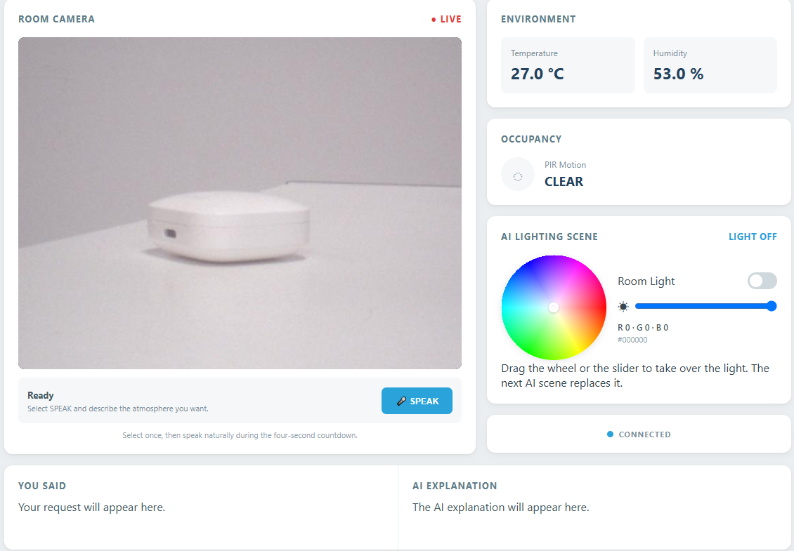

.. include:: /index.rst
   :start-after: start_hello_message
   :end-before: end_hello_message

10 AI Context-Aware Room Assistant
==================================

Every project in this module has handed the model one kind of input: a sentence to answer, a picture to describe, a story to write. This one hands it two at once — what you say, and what the room is actually doing. You tell it how you feel or what you are about to do; it reads the temperature, the humidity, and whether anybody is moving; and it answers with light. Say *"I'm in a bad mood"* and the lamp turns soft and warm and dim. Say *"I want to read a book"* and it turns cool and bright. And for the first time in this module the light is yours as well: a colour wheel, a brightness slider, and a switch sit right beside the AI's decision, so you can take over whenever you like.



In this lesson, you will learn to:

* Put two kinds of context into one request — the spoken words and the live sensor readings — and let the model weigh both
* Turn a **feeling** into hardware: describe a mood-to-light table in the system prompt instead of listing colours
* Give the model a fixed JSON contract and check every field before it reaches a pin
* Add a manual control that shares the same output as the AI, and decide what happens when the two disagree
* Recognise the failure that matters most here: an answer that is perfectly shaped and still wrong, because the prompt never taught the model what the words mean

1. Setup
--------

**What You Need**

.. list-table::
   :widths: 25 25 25 25
   :header-rows: 0

   * - 1 * Pan Tilt Kit
     - 1 * :ref:`cpn_humiture_sensor`
     - 1 * :ref:`cpn_pir`
     - 1 * :ref:`cpn_rgb_led`
   * - |list_pan_tilt|
     - |list_dht11|
     - |list_pir|
     - |list_rgb_led|
   * - 3 * :ref:`cpn_resistor` (220Ω)
     - 1 * :ref:`cpn_breadboard`
     - Several :ref:`cpn_wires`
     - 1 * USB Cable
   * - |list_220ohm|
     - |list_breadboard|
     - |list_wire|
     - |list_usb_cable|

**Software Requirements**

This project uses four App Lab **Bricks** — support packages that App Lab adds to your app for you:

* ``web_ui`` — serves the dashboard and keeps the browser, the sensors, and the AI in step
* ``cloud_llm`` — sends your request, the room readings, and the response contract to a cloud language model
* ``sunfounder_stt`` — turns your recorded speech into text. This project uses its **online** mode, so no speech model has to run on the board
* ``sunfounder_tts`` — speaks the assistant's explanation on the board's speaker

Because both the model and the online speech-to-text are reached over the internet, the project needs a key of your own. ``app.yaml`` declares ``cloud_llm`` and ``sunfounder_stt`` with empty key fields, so App Lab asks you for an **OpenAI API key** the first time you press **Run** and stores it for you. The board also needs a working internet connection — and one that can actually reach OpenAI, which is worth testing before you blame your wiring.

The sketch declares no libraries of its own in ``sketch.yaml``. The two headers it includes — the Bridge library and the DHT sensor library — ship with the app's support packages, so there is nothing to install by hand.

.. note::

   The first time you run a TTS example on this UNO Q, App Lab needs to download and prepare the TTS runtime and audio dependencies. This may take half an hour or more, depending on your network connection.
   The first time you run this project, App Lab asks for your **OpenAI API key**, because the app reaches the model through the ``cloud_llm`` brick and the speech-to-text service through ``sunfounder_stt``. Paste one key from your OpenAI account into both fields and save it — App Lab keeps it for your board, so you only do this once.

**Wiring Diagram**

The PIR module's **OUT** pin goes to **D4**, the DHT11's **DATA** pin to **D5**, and the RGB LED's three anodes go to **D6** (red), **D7** (green), and **D8** (blue), each through its own **220Ω** resistor, with the longest leg — the **common cathode** — to **GND**. Never connect a colour channel straight to a pin without its resistor; the LED can burn out.

.. image:: /img/wiring/wiring_context_room.png
   :width: 600
   :align: center

2. Run the App
--------------

#. Download :download:`10 AI Context-Aware Room Assistant.zip <https://github.com/sunfounder/unoq-ai-kit/releases/latest/download/10.AI.Context-Aware.Room.Assistant.zip>`.
#. In App Lab, go to **Apps** → **Create new app** → **Import App** → **Import from Computer**, and open the package you downloaded.
#. Click the **Run** button (▶) in the top-right corner. The sketch starts by switching the light off and reading the sensors, then the Python side opens the camera and starts the Web UI.

   .. image:: /img/app_run.png
      :width: 500
      :align: center

The **Web UI** tab opens by itself — the next section walks through what to do with it.

**How it Works**

Here is the whole path a request travels — in through the microphone, past the sensors, up to the cloud, and back out as light and speech.

An App Lab project is a folder of files. Here is what is inside this one:

* ``10 AI Context-Aware Room Assistant/`` — the app folder

  * ``app.yaml`` — app metadata: name, icon, and the four Bricks the project declares
  * ``README.md`` — a short guide to the project

  * ``python/``

    * ``main.py`` — the camera loop, the sensor polling, the speech request, the JSON parser, the light control, and the Bridge calls

  * ``sketch/``

    * ``sketch.ino`` — the DHT11 and PIR readers, the PWM light writer, and the three Bridge functions
    * ``sketch.yaml`` — sketch configuration for the UNO Q board

  * ``bricks/``

    * ``sunfounder_stt/`` — the speech-to-text brick the app ships with, in its online mode
    * ``sunfounder_tts/`` — the text-to-speech brick the app ships with: the local voice server behind ``tts.say()``

  * ``assets/``

    * ``index.html`` — the dashboard: camera frame, voice panel, environment, occupancy, the light control, and the two conversation cards
    * ``app.js`` — browser logic: the socket events, the colour wheel, the brightness slider, and the stream retry
    * ``style.css`` — the visual styling of the page
    * ``libs/socket.io.min.js`` — the Socket.IO client that carries messages between the page and the board
    * ``img/sf_logo.png`` — the logo in the page header
    * ``docs_assets/`` — the result image used by this documentation

The data path, from one sentence to a room that has changed colour:

.. mermaid::

   sequenceDiagram
       participant B as Browser (HTML/JS)
       participant P as Python (main.py)
       participant S as Sketch (sketch.ino)
       participant T as STT (OpenAI)
       participant L as LLM (gpt-4o-mini)

       B->>P: socket.emit("start_scene_request")
       P->>P: stt.start_listening() - four seconds of audio
       P->>T: the recording, as a file
       T-->>P: the recognized sentence
       P->>S: Bridge.call("read_dht") and Bridge.call("read_pir")
       S-->>P: "T=26.8,H=55.0" and 0 or 1
       P->>L: the sentence, the readings, and the system prompt
       L-->>P: one JSON object with scene, red, green, blue, brightness, reply
       P->>P: parse_scene() - five numbers and a colour name
       P->>S: Bridge.call("set_rgb_scene", "100,45,10,25")
       S->>S: analogWrite() on D6, D7 and D8
       P-->>B: socket "assistant_status" - scene, values, reply
       P->>P: tts.say(reply)
       B->>P: socket.emit("set_rgb_color", {r, g, b, brightness})
       P->>S: Bridge.call("set_rgb_scene", ...) - your colour wins

Here is what each piece does:

**Sketch (sketch.ino)** — runs on the STM32 MCU
  * ``setup()`` starts the DHT11, sets the three light pins as outputs, switches the light off with ``setRgbPercent(0, 0, 0, 0)``, and publishes three functions with ``Bridge.provide()``
  * ``setRgbPercent(red, green, blue, brightness)`` is the only place a pin is written: it scales brightness into a 0–100 percentage and calls ``analogWrite()`` on **D6**, **D7**, and **D8**

**Python (main.py)** — runs on the Linux MPU
  * ``Camera(fps=10)`` is the camera setup, and ``camera_loop()`` flips each frame, compresses it to JPEG, and parks it in a shared ``current_frame`` so the page can stream it without blocking anything else
  * ``ui.expose_api("GET", "/stream", video_stream)`` adds the MJPEG route the browser shows in an ````

**Cloud LLM (behind the ``cloud_llm`` brick)** — runs on OpenAI's servers
  * The **system prompt** is where this project's taste lives.
  * It also tells the model to use the real temperature, humidity, and motion readings as extra context — a hot room suits a cooler colour, a dark room suits lower brightness

**Bridge** — the channel between the MPU and the MCU
  * Sketch side: ``Bridge.provide("set_rgb_scene", ...)``, ``Bridge.provide("read_dht", ...)``, and ``Bridge.provide("read_pir", ...)``
  * Python side: ``Bridge.call("set_rgb_scene", values)``, ``Bridge.call("read_dht")``, and ``Bridge.call("read_pir")``

**Browser (HTML/JS)** — runs in your browser
  * ``socket.emit('start_scene_request', {})`` is sent by the **SPEAK** button, and the button is disabled whenever the app is busy
  * ``socket.on('assistant_status', update)`` repaints everything at once: the status panel, the temperature, the humidity, the motion state, the two conversation cards, the scene name, and the light control

Notice what this project adds to the pattern *the model decides, the code enforces*. The code still owns the shape of the answer — five integers and a string, clamped and trimmed.

3. Experiment
-------------

**Ask for a Feeling, Not a Colour**

None of the sentences below name a colour or a brightness. Each one describes a mood or a plan and leaves the light entirely to the model — and the model answers with values that were never in the page, the sketch, or the Python file:

.. list-table::
   :header-rows: 1
   :widths: 34 20 20 26

   * - What you say
     - Scene
     - RGB
     - Brightness
   * - *"I'm in a bad mood."*
     - soft warm amber
     - 100 / 45 / 10
     - 25
   * - *"I want to read a book."*
     - focused reading
     - 60 / 80 / 100
     - 85
   * - *"Let's have a party!"*
     - vivid celebration
     - 100 / 20 / 90
     - 90
   * - *"I feel sleepy."*
     - deep warm dim
     - 90 / 35 / 15
     - 15
   * - *"It is so hot in here."*
     - cool neutral
     - 60 / 80 / 100
     - 85

Work down the list with the room in the same state each time. The temperature and humidity cards do not change, the sentences are all the same length, and the light is completely different every time — because the only thing that changed was the meaning.

4. Troubleshooting
------------------

**Every attempt ends with "No speech was recognized"**

* **Cause:** The recording is fine — this project uses the **online** speech-to-text service, so the audio has to travel to the cloud before it can become text.
* **Solution:** Check the board's connection to the internet rather than the wiring: open the Output window, and look for lines about the speech service or a network error.

**The light never changes, and the panel still says "Ready"**

* **Cause:** Nothing was ever asked for, or the request failed before it reached the light.
* **Solution:** Wait for the bottom-right pill to read **CONNECTED** before pressing **SPEAK**, and watch the panel while the request runs — if it turns red, read the exception in the message, which names the step that failed.

**Temperature and humidity stay on "Unavailable"**

* **Cause:** The DHT11 is not answering.
* **Solution:** Check the three legs of the sensor against the wiring diagram — data to **D5**, power and ground the right way round — then stop the app and press **Run** again.

5. Summary
----------

You just built an assistant that listens to you and looks at the room at the same time, and then changes the light because of it. In this lesson, you learned:

* Two kinds of context — words and sensor readings — can travel in one request, and the model weighs them together
* A system prompt can describe a **feeling-to-hardware** table, which is how *"I'm in a bad mood"* becomes warm amber at 25 per cent instead of a bright cool scene
* ``parse_scene()`` treats the answer as untrusted input: it finds the braces, parses them, and clamps every number before anything reaches a pin
* A manual control and an AI decision can share one output, and the interesting question is not who is allowed to write the value but who should win
* The hardest failure in this project is invisible to a compiler: a reply that is right in form and wrong in meaning can only be fixed in the prompt, not in the parser

The pattern from the rest of this module — an input, a model, and a page that shows you what happened — has one new member here. Until now your code decided everything the model was not allowed to do. Now your code also has to decide what the model *should* do, and it says so in English, in a prompt, where the mood table is the difference between a lamp that reacts and a lamp that understands.
