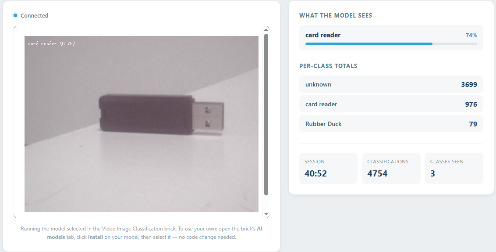

# 09 Train Your Own AI Model

Swap the built-in model for one you train yourself. This app runs whichever image-classification model the Video Image Classification brick is set to, and turns the camera into a test bench: it shows what your model sees, how confident it is, and how often each class shows up during a session.

## Software

### Bricks Used

This example uses the following Bricks:

- `video_image_classification` — Runs the image-classification model on every camera frame. It uses the model selected in its Brick Configuration, so the same app works with the built-in general model and with one you trained yourself in Edge Impulse Studio
- `web_ui` — Creates the web interface and provides real-time communication between the browser and the Python backend

## Hardware

- Pan Tilt Kit ×1
- USB-C cable ×1

## Wiring

The CSI camera is built into the AVIO Carrier, so no breadboard wiring is needed - just attach the carrier to the UNO Q.

## How to Use the Example

1. Download [`09 Train Your Own AI Model.zip`](https://github.com/sunfounder/unoq-ai-kit/releases/latest/download/09.Train.Your.Own.AI.Model.zip).
2. In App Lab, go to **Apps** → **Create New App** → **Import App** → **Import from Computer** and open the package you downloaded.
3. Open the **Video Image Classification** brick, switch to its **AI models** tab and click **Train new AI model** - the lesson walks you through Edge Impulse Studio from there.
4. Back in App Lab, click **Download** on your new model and select it in the brick's **Brick Configuration**.
5. Click **Run** and open the Web UI - the app now reports the classes you trained, each with its own confidence bar and running total.

The brick also runs the built-in general model, so you can press **Run** at any point to try the app before you train.

## Use Your Own Model

Nothing in this project names a model: the brick runs whichever one is selected in its configuration, so a model you train yourself is used without changing a single line of code.

1. Open the **Video Image Classification** brick in App Lab and switch to its **AI models** tab. The models already on your board are listed there.
2. Click **Train new AI model** and follow the lesson to build one in Edge Impulse Studio.
3. When training finishes, your model appears in the same list, marked as coming from **Edge Impulse**. Click **Download** on it and wait for it to be copied to the board.
4. Select the model so that it is the one **in use** — the selected card is the model the brick runs. To go back to the built-in model, select that one instead.
5. Press **Run**. The Web UI now reports the classes your model knows (for example `card reader`, `Rubber Duck`, `unknown`), and logs them to the Console.

**Seeing the result**

- This app's **Web UI** lists what the model sees right now, with a confidence bar for each label, plus a running total that counts how often each class won.
- The brick also serves its own view of the model at `http://<board-ip>:4912`, which puts the live classification over the video.
- Every time the leading class changes, the same result is printed in App Lab's **Console**.

## How it Works

**Flow**

- Camera (`Camera` peripheral) — keeps producing frames in the background; each one is flipped vertically because the CSI camera is mounted upside down
- Brick (`video_image_classification`) — runs the selected model on every frame and hands the results to Python
- Python (`main.py`) — collects what each frame contained, keeps a running total per class, and pushes a snapshot to the browser with `ui.send_message("model_report", ...)`
- Browser (`assets/app.js`) — draws the live list, the per-class totals and the session counters next to the video stream served on port 4912

**The app never names a class**

`on_detect_all()` delivers a dictionary whose keys are the class names of whichever model is running, and whose values are the instances found in that frame. Python passes those names straight through, so a model trained on "apple" and "banana" needs no code change at all - the page simply shows two new rows.

**Class names are escaped before they are shown**

Every label is escaped in `app.js` before it reaches the page, so a class name from your dataset can never be treated as HTML.

**A heartbeat keeps the page alive**

The model only calls back when a frame has been analysed, which may not happen while the camera stares at an empty wall. A small `loop()` sends the same snapshot every 0.4 s, so the session timer keeps ticking and the empty state stays accurate.
