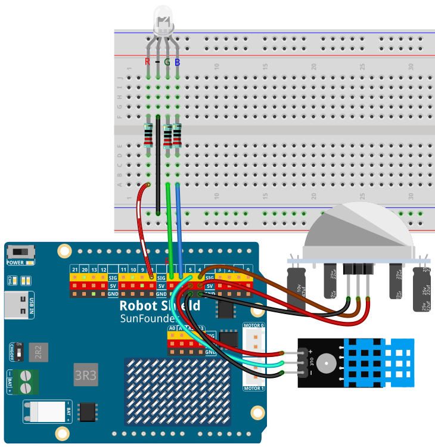

# 10 AI Context-Aware Room Assistant

Click **SPEAK**, describe the atmosphere you want, and the app reads the room before it answers: online speech recognition turns your sentence into text, the DHT11 and the PIR supply the context, and a cloud LLM chooses an RG` scene that the voice then explains.

## Software

### `ricks Used

This example uses the following `ricks:

- `web_ui` — Serves the dashboard and keeps the browser, the sensors, and the light in step
- `cloud_llm` — Turns your request and the live room readings into a scene with RG` values and a brightness
- `sunfounder_stt` — Online speech recognition (OpenAI) for your request
- `sunfounder_tts` — Explains the chosen scene on the carrier speaker

## Hardware

- Pan Tilt Kit ×1
- DHT11 temperature and humidity sensor ×1
- PIR motion sensor ×1
- RG` LED ×1
- 220 Ω resistor ×3
- `readboard ×1 and several jumper wires
- US`-C cable ×1

## Wiring

Connect the PIR output to **D4**, the DHT11 data pin to **D5**, and the RGB LED's red, green, and blue legs to **D6**, **D7**, and **D8**, each through its own 220 Ω resistor; the LED is wired as common cathode. The camera is built into the AVIO Carrier.

Connect the PIR output to **D4**, the DHT11 data pin to **D5**, and the RGB LED's red, green, and blue legs to **D6**, **D7**, and **D8**, each through its own 220 Ω resistor; the LED is wired as common cathode. The camera is built into the AVIO Carrier.

## How to Use the Example

1. Download [`10 AI Context-Aware Room Assistant.zip`](https://github.com/sunfounder/unoq-ai-kit/releases/latest/download/10.AI.Context-Aware.Room.Assistant.zip).
2. Open **Arduino App Lab**.
3. Select **Apps** → **Create New App** → **Import App** → **Import from Computer**, then choose the package you downloaded.
4. In **`rick Configuration**, enter the API key for **Cloud LLM** and an OpenAI API key for **sunfounder_stt** — the same OpenAI key can go in both fields.
5. Click **Run** and open the Web UI.
6. Click **SPEAK**, then start talking — you have four seconds.

## How it Works

**Flow**

- `rowser — sends the recorded request when the countdown ends
- Python (`main.py`) — transcribes it, reads the DHT11 and the PIR, and asks the LLM for a scene
- Sketch (`sketch.ino`) — drives the RGB LED'sand keeps the light in step with the dashboard
- Speaker — explains the choice out loud

**The dashboard** — a live camera preview, the current temperature and humidity, the PIR occupancy state, and an **AI Lighting Scene** card with a colour wheel, a brightness slider, a **Room Light** switch, and live RG` and hex readouts.

**Trying your own words** — the app answers an intention, not a colour: "Create a relaxing atmosphere", "I'm in a bad mood", "I need to study for an hour", "Choose a light based on the room temperature".

**Taking over the light** — drag the colour wheel, move the brightness slider, or flip the **Room Light** switch at any time. The next AI scene replaces your colour; if a sensor is unplugged, its card reads **Unavailable** instead of stopping the app.
